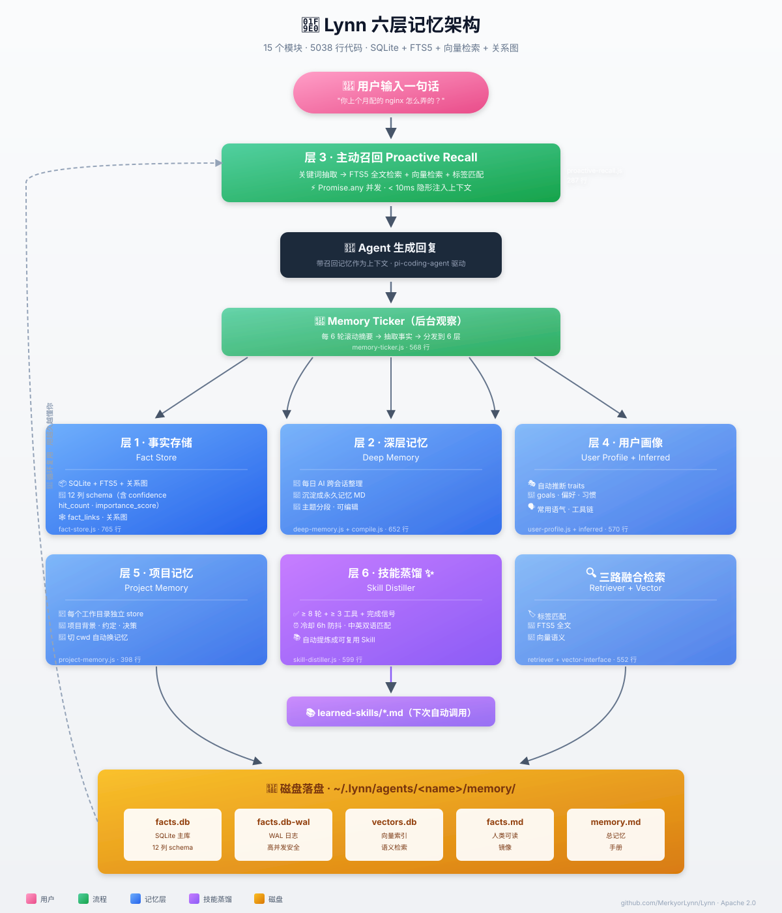
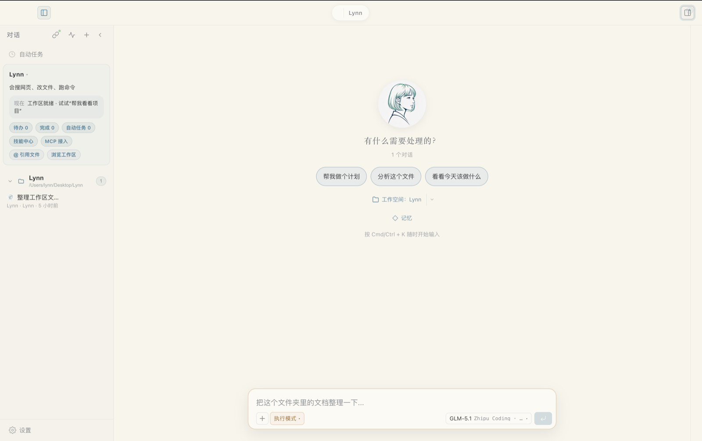

[English](README_EN.md) | **中文**

<p align="center">
  
</p>

<h1 align="center">Lynn</h1>

<p align="center"><strong>开源桌面 AI 助手 · 聊天与任务进度一目了然 · 实时语音 · 长期记忆</strong></p>
<p align="center">主界面专注聊天:随时看清每个对话进行到哪、还有什么要处理,顺手管理文件、确认它做的每一处改动。需要同时推进多个任务时,Lynn 的命令行还能作为后台 worker,被 Codex / Claude / Qwen 等工具调用。</p>

<p align="center">
  <a href="LICENSE"></a>
  <a href="https://github.com/MerkyorLynn/Lynn/releases"></a>
  <a href="https://github.com/MerkyorLynn/Lynn/releases"></a>
  <a href="https://github.com/MerkyorLynn/Lynn"></a>
  <a href="https://github.com/MerkyorLynn/Lynn/releases"></a>
  <a href="https://huggingface.co/nerkyor"></a>
  <a href="https://modelscope.cn/models/Merkyor/Qwen3.8-27B-Coder390-EfficientThink-Opus5.5-GPT6Astra-Grok4.7-DSV4Pro-K3-SFT-RLOO-GGUF-NInfer"></a>
  <a href="https://www.typescriptlang.org/"></a>
  <a href="https://www.electronjs.org/"></a>
</p>

---

## Lynn V0.87.5 · Step 5 云端 + Coder390 本地

Lynn 是同时提供桌面 GUI 与独立 CLI 的开源 AI Agent：用对话完成搜索、文件处理、代码任务和实时语音，也可以作为其他 Agent 或 CI 的无头 worker。**当前 GUI / CLI 均为 V0.87.5，默认工作模型为 Step 5 Preview。**

[国内下载页（推荐）](https://download.merkyorlynn.com/download.html) · [V0.87.5 发布说明](https://github.com/MerkyorLynn/Lynn/releases/tag/v0.87.5) · [GitHub 主仓](https://github.com/MerkyorLynn/Lynn) · [GitHub 备份仓](https://github.com/LynnMerkyor/Lynn) · [Gitee](https://gitee.com/merkyor/Lynn)

### 当前模型与运行方式

| 用途 | 当前方案 | 使用方式 |
|---|---|---|
| 默认对话、编码与工具任务 | **Step 5 Preview**（`step-5-preview`） | GUI / CLI 默认由 Brain 托管 |
| 默认云端图片理解 | **Step 5 原生视觉** | 直接发送图片，无需另配视觉 API Key |
| 实时语音对话 | **StepAudio 2.5 Realtime**（`stepaudio-2.5-realtime`） | GUI 麦克风；CLI 对话内 `/voice` 或 `lynn voice` |
| 本地文本与代码任务 | **Qwen3.8-27B Coder390 EfficientThink** | 设置中明确选择、安装、启动 llama.cpp Q2 / Q3 |
| 自备模型 | 用户配置的服务商或兼容端点 | 在模型设置中选择，不以路由别名冒充实际模型 |

### 本地模型：Coder390 Q2 / Q3

模型来源：[Merkyor / Qwen3.8-27B-Coder390-EfficientThink](https://modelscope.cn/models/Merkyor/Qwen3.8-27B-Coder390-EfficientThink-Opus5.5-GPT6Astra-Grok4.7-DSV4Pro-K3-SFT-RLOO-GGUF-NInfer)。Lynn 使用该仓库的 [`GGUF/` 目录](https://modelscope.cn/models/Merkyor/Qwen3.8-27B-Coder390-EfficientThink-Opus5.5-GPT6Astra-Grok4.7-DSV4Pro-K3-SFT-RLOO-GGUF-NInfer/tree/master/GGUF)，**不是 NInfer 版本**。

| 方案 | 推荐容量 | 模型文件大小 | 初始上下文 |
|---|---|---|---|
| **Coder390 Q2** | **16GB** 显存 / Apple 统一内存 | 13.28GB | 4K，单并发 |
| **Coder390 Q3** | **24GB 及以上**；系统报告值至少 23.5GiB | 17.30GB | 8K，单并发 |

- 两档均为 **llama.cpp GGUF，内置 Q4 MTP**；不另下载 DFlash2，不安装 NInfer，本次本地安装不含视觉组件。
- Apple Silicon 检测统一内存；NVIDIA 检测最大单卡显存，不叠加多卡，也不以系统内存代替显存。
- **低于 14GiB（例如 13GB）或检测失败，禁止安装和启动。** 14～不足 16GiB 仅达到 Q2 最低门槛，不等于推荐配置。
- 模型文件大小不等于实际内存占用；上下文缓存、运行缓冲与系统仍需空间。
- 安装与启动由用户明确操作；切换档位不静默删除已有模型文件。设置页提供 Q2 / Q3，不再以旧 9B / 4B 作为当前安装推荐。

### V0.87.5 重点更新

- **CLI 命令菜单可选择**：输入 `/` 后用 ↑↓ 移动，Tab / Enter 填入选中命令；支持滚动与键盘操作。
- **设置草稿更可靠**：按 Agent 保留未保存内容，切换设置页、刷新模型配置时保留草稿与经验列表。
- **会话执行更稳定**：修复并发工具结果匹配、桥接会话排队、上下文压缩和回复显示问题。
- **本地模型启动可恢复**：启动超时明确报错，允许手动重试，旧进程退出不会覆盖新进程状态。
- **文件与界面操作更稳妥**：修复文件访问和预览边界，为删除、撤回与高风险操作补充确认；完善菜单和设置控件键盘操作。
- **GUI / CLI 同步更新**：升级桌面与内置运行时依赖，延续 Step 5、实时语音及 Coder390 Q2 / Q3。

### 延续的对话与会话能力

- **长推理不断流**：OpenAI 兼容端点和内置 Qwen 桥接统一使用首段 600 秒 / 空闲 600 秒，持续输出刷新计时，默认不设模型总时限，不会因总耗时超过十分钟而中断。设置页可调整并查看实际值及环境变量来源；已保存的设置和显式环境变量继续优先，CLI 使用 `Lynn doctor --offline` 诊断。
- **短答案不乱续写**：不再根据字数、语言或末尾标点判断截断；仅在模型明确返回 `finish_reason=length`，或只有推理没有可见答案时尝试一次恢复。
- **真正删除会话**：会话菜单提供二次确认删除，归档列表支持单条删除与批量清空；停止在途请求并删除会话文件，避免迟到输出重新写回。详见[超时与删除说明](docs/ops/local-stream-timeouts-and-session-deletion.md)。

延续 V0.87.1 的模型与工具能力：

- **模型决定参数，工具只执行**：天气、体育、行情和汇率接收模型提供的地点、日期、联赛、代码及货币对，不从整句问题硬编码抽取实体。复合地点保留原意，必要时由模型补充上级地点或坐标。
- **GUI / CLI 同一默认模型**：Step 5 处理日常对话、编码、工具任务与云端图片理解。
- **实时语音恢复**：StepAudio 2.5 Realtime 共用 Brain 托管链路；CLI 语音可在当前对话进入，`Ctrl+C` 返回聊天。
- **复查与证据**：修复手动复查遗漏设备鉴权；实际识图、手动复查和并发复查纳入安装包验证，错误兜底不冒充成功结果。
- **本地安装条件明确**：按硬件容量推荐 Coder390 档位，校验固定文件大小与 SHA-256，保留旧文件和手动导入入口。

非阻断的复查相关性、识图重复收尾等观察见[后续版本跟进清单](docs/ops/v0871-follow-ups.md)。后文历史版本记录中的旧模型和研究数据不代表当前默认配置或 Coder390 的评测结果。

### GUI 与 CLI 怎么分工

桌面端管理对话、文件、任务进度与改动确认；CLI 提供终端交互、代码任务和无头 worker。两者共享默认模型与工具执行能力。CLI 可输出机器可读的 JSON / JSONL，供终端、CI 或其他 Agent 调用，无需把桌面窗口当作自动化接口。

### CLI 快速安装

Lynn CLI 提供终端 TUI、Markdown 渲染、流式输出、工具调用和长任务续跑，既可交互使用，也可作为其他智能体和 CI 的无头 worker。**一行命令安装 V0.87.5，不用克隆仓库或自行编译。**

```bash
# 1. Node requirement: Node.js 20 LTS or 22 LTS with npm.
# Check: node -v should be >= v20.
# macOS: brew install node@20
# macOS/Linux: nvm install 20 && nvm use 20
# Windows: winget install OpenJS.NodeJS.LTS

# 2. Install or update from the Lynn mirror. --force is safe for first install too.
npm install -g --force "https://download.merkyorlynn.com/downloads/cli/lynn-cli-0.87.5.tgz?rev=20261031"

# 3. Launch.
Lynn            # interactive chat TUI; 输入 /voice 或 lynn voice 进入实时语音
Lynn code       # coding-agent TUI
Lynn --version  # should print 0.87.5
Lynn agents     # copyable headless worker commands for other agents
```

默认走 Brain V2 路由:本地 Lynn Brain 可用时优先本地,不可用时自动回到 Lynn 远端 Brain。V0.87.5 的 GUI/CLI 普通对话与任务执行统一使用 **Step 5 Preview (`step-5-preview`)**，默认视觉也由 Step 5 直接处理，无需独立视觉 API Key；语音由 Brain 托管 **StepFun Realtime (`stepaudio-2.5-realtime`)** 承接,CLI 当前 chat 内 `/voice` / `lynn voice` 与 GUI 麦克风默认就是实时语音对话。本地 manager 作为显式 `Lynn manager run` 实验链路保留,不会抢占默认 GUI/CLI 路径。纯 CLI 用户也可以用 `Lynn providers set ...` 绑定自己的 OpenAI 兼容端点。

长任务默认采用 Reasonix 风格的**前置缓存纪律**:稳定前缀、工具定义、运行时约束和 resume 摘要分层固定,避免每轮重排导致 prefix drift;缓存命中以 `prefix-cache ... hit` 进入 usage、session、replay 和 `Lynn cache doctor --json`,不在界面里制造上下文焦虑。

面向其他智能体的最短静默契约:

```bash
Lynn code -p "fix tests, run the suite, summarize the diff" \
  --json \
  --cwd /path/to/worktree \
  --approval yolo \
  --sandbox danger-full-access \
  --save-session
```

需要“穷尽最优解”时用 `--best`(或 `/goal` / `/best` 交互入口):Lynn 会启用 300 步预算、ultra 任务分解、原子 worker、对抗式验收、自动验证、checkpoint/resume 和运行时压缩。它不会用路由替模型选答案,只负责拆步、调度、验证和防工具风暴。

机器调用请只解析 JSONL,不要解析人类 TUI。完整契约见 [`docs/ops/lynn-code-headless-agent-contract.zh.md`](docs/ops/lynn-code-headless-agent-contract.zh.md) / [`English contract`](docs/ops/lynn-code-headless-agent-contract.md)。

### Agent Quick Contract

`Lynn` 也可以作为给 Codex / Claude Code / Qwen / Kimi 调用的 worker-runner。交互式 TUI 给人看;机器调用请用 `-p --json` 或 `worker run --jsonl`。

```bash
# 单次无交互任务,打印 JSON/JSONL 后退出。
Lynn -p "总结这个 repo" --json
git diff | Lynn code -p "审查这个 diff,只输出风险和测试建议" --json

# 无头 worker:给终端、CI 或其他 Agent 调用的统一适配器。
Lynn worker run --brief task.md --worktree . --jsonl
Lynn worker run --brief task.md --worktree . --agent codex-cli --jsonl
Lynn worker run --brief task.md --worktree . --agent claude-code --jsonl
Lynn worker run --brief task.md --worktree . --agent qwen-cli --jsonl
```

一个 `--agent` 把任务派给 Codex / Claude Code / Qwen / Kimi / CodeBuddy / OpenCode 或 Lynn 自身,统一吐 Fleet JSONL。安全边界守在 Lynn 侧(ownership / forbidden-glob / diff 校验 / gate),不依赖外部 worker 自觉。

成功信号 = `gate.finished.ok`;硬失败 = `worker.violation` 或 `worker.error{recoverable:false}`。完整规范(BYOK 配置 / agent 适配表 / 全事件 schema / code tools)见 [`docs/ops/lynn-cli-agent-contract.md`](docs/ops/lynn-cli-agent-contract.md)。

## 🆕 近期更新

当前版本为 **V0.87.5**，更新与安装要求见本文顶部。以下为历史版本记录，其中的模型、容量和路由仅描述对应旧版本，不是当前安装建议。

<details>
<summary><strong>Lynn v0.87.0</strong> · 2026-09-08 · 窗边树影与更简洁的工作界面</summary>

- **Lynn 窗边树影**：右上角小叶影轻微摇曳，默认开启；顶部“树影”可查看关闭路径并打开设置，后台暂停，减少动态效果时静止。
- **更轻的输入栏**：任务模式改为可编辑的斜杠模板；深度调研、写作布局和执行权限仍可直接使用。
- **统一文件入口**：图片并入文件面板的筛选，旧画廊目录和生成图片继续保留。
- **安静的消息与提示**：翻译收进消息菜单，聊天不再主动推荐安装本地模型；模型设置仍可安装。
- **按需专家**：专业顾问与圆桌移为[可选插件](optional-plugins/expert-roundtable/README.md)，旧角色、频道和历史保留。
- **直接表达与按需复查**：新回答不再要求固定情绪区块，旧消息仍可显示；普通搜索与轻量编辑减少自动复查，重要结果与手动复查保留。
- Kimi MCP 扫码登录、历史搜索、会话文件、自动化与手机续聊继续提供。

[Release notes](https://github.com/MerkyorLynn/Lynn/releases/tag/v0.87.0)

</details>

<details>
<summary><strong>Lynn v0.86.8</strong> · 2026-09-08 · 扫码接入 Kimi、历史搜索与手机续聊</summary>

- **Kimi Datasource**：在 MCP 设置中扫码登录自己的账号，自动连接内置官方数据源，无需安装 Kimi CLI。
- **MCP OAuth**：支持 HTTP/SSE 授权发现、PKCE、本机回调与令牌刷新。
- **会话与文件**：搜索历史正文和命中片段；文件使用会话级编号，上传在发送时绑定会话并保留副本。
- **轻量自动化**：直接提醒、指定插件动作与原有 Agent 任务并存，保留通知和运行记录。
- **手机续聊**：显式开启手机访问，扫码配对并可撤销；继续已有会话和收发文件，安装 PWA 需要 HTTPS。
- **可选树影**：界面中增加默认关闭的树影层。

[Release notes](https://github.com/MerkyorLynn/Lynn/releases/tag/v0.86.8)

</details>

<details>
<summary><strong>Lynn v0.86.7</strong> · 2026-09-07 · 显存分档安装与部署助手</summary>

- **Q3 / Q2 按显存推荐**：当时的端侧默认是 Qwen3.8-27B EfficientThink SimPO。24GB 及以上独立显存推荐 Q3 + Q4 DFlash2，16GB 独立显存推荐 Q2 + Q4 DFlash2。
- **配齐运行组件**：检查或安装兼容的 llama.cpp，主模型与独立 Q4 DFlash2 分别按固定字节数和 SHA-256 校验，健康检查通过后才切换模型；已有文件保留。
- **遇到问题能继续处理**：模型卡入口、手动档位、暂停续传，以及“让 Lynn 帮我部署”。系统信息、选择和错误整理为对话草稿，不自动发送。
- **区分组件角色**：这一版 DFlash2 使用 draft-dflash，不是 draft-mtp。Windows 沿用未签名 NSIS 与内置基础 CPU 运行时；新 GPU 运行时在明确授权后准备。

[模型卡与完整要求](https://modelscope.cn/models/Merkyor/Qwen3.8-27B-EfficientThink-K3-Opus5-Grok4.6-GPT5.6Sol-SFT-SimPO-DFlash2-GGUF)

</details>

<details>
<summary><strong>Lynn v0.86.6</strong> · 2026-09-05 · 自动任务可靠性与长会话性能 </summary>

- **Harness 快速终态不再丢失**：修复启动响应与完成/失败通知同批到达时持续等待的问题；子进程提前退出也会立即结束等待。包含 v0.86.5 的全部 UI/架构修复。
- **长回答不再被小于号截断**：修复“耗时 < 5 分钟”等比较表达式误触发标签清理的问题，并增加完整答案的分块重放回归。
- **自动任务无损编辑**：保留月度、范围、步长和一次性/间隔计划；指定模型可恢复默认。
- **保存与测试分离**：测试失败会保留已保存的任务 ID，持续提示失败原因，重试不再重复创建任务。
- **IM 会话隔离**：快速切换会话时，旧请求的成功或失败都不会覆盖当前对话。
- **长会话性能**：首屏加载最近 80 条消息，向上分页；富文本按页面保留可见区域，长回复按规模调整刷新节奏。
- **编辑器按需加载**：CodeMirror 核心与可选语言解析器分离，并新增编辑器入口体积门禁。
- **工程与 UI 门禁**：已有任务/新建模板分入口，设置样式、评审策略/执行及 CLI 持久化职责拆分；截图门禁加载真实翻译并覆盖编辑、复杂计划和失败重试。

[完整 Release Notes →](https://github.com/MerkyorLynn/Lynn/releases/tag/v0.86.6)

</details>

<details>
<summary><strong>Lynn v0.86.4</strong> · 2026-09-01 · 自动任务 UI 与渲染按需加载</summary>

**v0.86.4 自动任务体验与前端工程更新**:
- **自动任务暗色模式可读性修复**：模板、任务卡、表单、状态标签和按钮统一使用主题语义变量，消除暗色背景上的浅色大块、白字和低对比度内容。
- **Automation 面板模块化**：数据读写、草稿状态、模板库和编辑器拆为独立模块，主面板只保留布局与流程编排；Automation 样式也从通用 Floating Panels 样式表迁出。
- **重型渲染器真正按需加载**：Mermaid、Wardley、KaTeX、Markdown 与 sanitize vendor 独立异步加载，并增加静态依赖检查，防止动态导入被其他引用抵消。
- **视觉回归进入发布门禁**：自动任务页面覆盖亮色/暗色与 1440×900、1024×768、720×900 三种视口，六组截图基线会在发布 UI 门禁中自动比对。
- **既有 Agent Loop 契约保持稳定**：Codex app-server 自动预检、原 Loop 回退、单轮本地模型接班、空答熔断和 GUI/CLI 终态追踪继续保留。

```bash
npm install -g --force "https://download.merkyorlynn.com/downloads/cli/lynn-cli-0.86.4.tgz"
```

[完整 Release Notes →](https://github.com/MerkyorLynn/Lynn/releases/tag/v0.86.4)

</details>

<details>
<summary><strong>Lynn v0.86.3</strong> · 2026-08-27 · Agent Loop 稳定性与确定性回退</summary>

**v0.86.3 Agent Loop 与跨端可靠性更新**:
- **Codex harness 自动选择更可靠**：可选 Brain 状态接口不可用时，不再误判为不支持，而是继续使用带认证的 Responses 真实预检；显式 `--harness codex` 同样必须通过当前 provider/model/auth 预检。人类可读的 headless 任务会在启动时显示实际 harness 与选择原因。
- **本地模型失败只做单轮 Brain 接班**：27B 本地模型无输出时可由 Brain 完成本轮，但不会永久修改会话选中的模型；排队中的下一轮也会恢复用户原本选择。
- **空答与隐藏推理空转有跨轮熔断**：候选模型只返回 reasoning 或空正文时会立即交给下一候选，并进入短暂 cooldown，避免下一轮再次命中同一坏节点。
- **Brain 多模态接班链升级**：StepFun 之后优先由 GLM Coding Plan 的 `GLM-5.3-Flash` 接班，随后使用同价但支持视觉输入的 `deepseek-v4-flash-vision-exp`；MiMo 2.5 Pro 保持第二次仲裁职责，旧的纯文本 DS V4 Flash 不再作为默认兜底。
- **CLI TUI 历史保持成对完整**：Ink 流正常结束但没有可见答案时，不再写入空 assistant 或保留 unmatched user；界面明确提示重发/切换模型，后续上下文不被污染。
- **GUI 结束事件可追踪来源**：普通、兜底、本地直连和强制收口均透传 `streamSource`，便于诊断答案来自用户主链、本地模型还是 Brain fallback。
- **Feishu 接口升级**：飞书桥迁移到当前 SDK Channel API，保留消息发送、回复、文件与卡片能力。

```bash
npm install -g --force "https://download.merkyorlynn.com/downloads/cli/lynn-cli-0.86.3.tgz"
```

[完整 Release Notes →](https://github.com/MerkyorLynn/Lynn/releases/tag/v0.86.3)

</details>

<details>
<summary><strong>Lynn v0.86.2</strong> · 2026-08-22 · Codex app-server harness 与 Agent 生命周期更新</summary>

**v0.86.2 Agent harness 与可靠性更新**:
- **`Codex app-server harness` 接入 Lynn Code**：线程、回合、流式事件、计划、工具生命周期、审批请求、压缩与中断统一映射到 Lynn 的 Agent 运行状态；原 Agent loop 完整保留。
- **默认 `auto`，任务开始前完成选择**：Lynn Code/CLI 先验证 app-server 可执行与协议兼容，再通过当前认证及 provider/model 做一次极短的真实 Responses 预检；任一条件不满足就直接使用原架构，不在执行中途切换。
- **不牺牲现有能力换新架构**：附件/多模态继续走已验证的 Lynn bridge；`--json` 保留逐工具审计流；`ask`/`never` 保留严格审批语义；ultra 多 worker 继续走原 loop。显式 `--harness codex` 仅允许已验证的普通 `yolo/on-failure` 路径，不兼容组合会明确报错；`--harness legacy` 可固定原架构。
- **GUI/CLI 共享可终结的运行状态**：CLI 记录 harness 选择；GUI 与 CLI 的 completed、failed、cancelled、partial、resumable 和工具终态使用同一契约，降低空答、重复收尾和取消后残留状态。
- **BYOK 与 Brain 各自保持原路由职责**：BYOK 仍使用用户配置的 provider/model；StepFun、DeepSeek V4 Flash、MiMo 与 GLM 等 Brain 模型继续由 Brain 路由，不因 harness 选择改变模型归属。
- **Windows 本地 GGUF 开箱即用**：v0.86.2 Windows 安装包内置固定版本的 `llama.cpp` runtime、依赖 DLL、许可证与 SHA-256 清单；发布门禁会从最终 NSIS 安装包反解并真实加载 GGUF，连续完成两次生成。

```bash
npm install -g --force "https://download.merkyorlynn.com/downloads/cli/lynn-cli-0.86.2.tgz"
```

[完整 Release Notes →](https://github.com/MerkyorLynn/Lynn/releases/tag/v0.86.2)

</details>

<details>
<summary><strong>Lynn v0.86.1</strong> · 2026-07-12 · GUI / CLI 交互与端侧模型管理更新</summary>

**v0.86.1 体验与可靠性更新**:
- **CLI Ink 退出链路修复**:忙碌时 Ctrl+C 只取消当前轮，REPL 保持可用；完整 Ink PTY 门禁要求 1 秒内取消并最终零退出。
- **CLI 质感与长会话稳定性**:历史输出改用 `Static` 保留，不再因固定条数截断；流式 Markdown 40ms 合批，工具开始/完成合并为同一行，输入框支持可见光标、左右移动和行首/行尾。
- **端侧 27B 下载可管理**:默认 Q4 imatrix MTP 下载显示真实总进度、分片、速度和剩余时间，支持暂停、断点继续、取消与删除；切到云端不再锁死安装流程。
- **本地模型提示不再每天打扰**:硬件不足仍不主动推荐，符合条件的设备可选择“7 天后提醒”或“不再提醒”；PID、端点和槽位收进诊断详情。
- **GUI 更容易找到内容**:会话搜索默认可见，长对话提供回到最新消息按钮；输入区低频功能收进“更多”，停止操作立即显示反馈。
- **错误与主题可读性**:网络、认证、超时和本地运行时错误统一显示人话；暖纸/深色主题提高次要文字对比度，并补齐跨主题语义变量。
- **高风险回答采用异构复核**:DS V4 Flash 继续异步快速复核；仅当医疗、法律、金融或时效事实回答被判为有疑点时，再由 MiMo 2.5 Pro Token Plan 做一次限时仲裁。仲裁不阻塞原回答、不触发自动重答，GUI 和 CLI 都会显示结构化结论。
- **V0.86 安全基线完整保留**:自动浏览器权限、OS 沙箱、IPC/SSRF、本地服务鉴权、会话互斥、工具取消和跨轮污染修复继续受安全测试与 Agent 回归门禁保护。

```bash
npm install -g --force "https://download.merkyorlynn.com/downloads/cli/lynn-cli-0.86.1.tgz"
```

[完整 Release Notes →](https://github.com/MerkyorLynn/Lynn/releases/tag/v0.86.1)

</details>

<details>
<summary><strong>Lynn v0.86.0</strong> · 2026-07-12 · 安全边界与全链路可靠性更新</summary>

**v0.86.0 安全、运行时与体验更新**:
- **自动浏览器默认拒绝敏感权限**:模型访问的网页不能静默获取麦克风、摄像头、定位或通知；所有导航和子资源请求都经过 DNS/SSRF 校验。
- **执行模式仍受 OS 沙箱保护**:授权确认不再等于完全放开系统；SSH、云凭证、浏览器用户数据、Lynn token 与 Agent 配置均禁止模型读取。
- **本地服务信任边界收紧**:IPC 只信任已知窗口对象，失败会返回可追踪错误；本地 HTTP/WS 校验 Host、Origin 与启动 token，敏感配置统一使用 0600 权限。
- **Windows 27B 启动修复**:支持通过 `where.exe` 发现 PATH 中的 `llama-server`；手动 GGUF 启动会返回真实 ready/失败状态，端口占用、缺 runtime、超时和崩溃都有明确提示。
- **会话可靠性**:同一 session 的 prompt admission 串行化，turn_end 四类兜底有独立单测；移除废弃 internal retry 状态，断线重放容量提升并可配置。
- **Brain 双层伪工具防线**:腾讯 Brain 已部署跨 chunk sanitizer，客户端仍保留末端清理；普通代码/JSX 文本不会被误删。
- **CLI 可控、可脚本化**:流式回答支持 Ctrl+C 取消；未知 flag 立即报错；命令级 help、非 TTY 退出码、manager/worker JSONL/纯文本行为一致，Windows 外部 worker 使用 argv 执行。
- **GUI 状态更可见**:Fleet 任务进入活动面板，语音显示 RTT/上下行统计，崩溃恢复给出提示；Bridge、模型状态和语音操作补齐中英文与键盘焦点管理。
- **发版门禁加固**:Brain mirror/prod 漂移检查、CLI100、GUI100、Agent regression、Windows/macOS 打包验证继续作为发布硬门槛。

```bash
npm install -g --force "https://download.merkyorlynn.com/downloads/cli/lynn-cli-0.86.0.tgz"
```

[完整 Release Notes →](https://github.com/MerkyorLynn/Lynn/releases/tag/v0.86.0)

</details>

<details>
<summary><strong>Lynn v0.85.10</strong> · 2026-07-11 · 会话进度与 Agent 可靠性更新</summary>

**v0.85.10 运行时与体验更新**:
- **会话进度更直观**:右栏只突出一次当前会话,最近会话默认收起详情；“打开会话”“新建分支”动作明确,键盘焦点和展开状态可访问。
- **防止回合状态串线**:每轮开始统一清理工具、重试、解析器、定时器和临时输出状态,避免“重新回答”后把上一题目标或结果带进下一题。
- **普通回答不再误生成文件**:只有明确要求报告、HTML、PDF、PPT、附件或导出物时才开放交付物工具；清单、设定表、代码和解释直接留在聊天正文。
- **Brain 兜底真正可执行**:Step、DS V4 Flash、MiMo Token Plan、端侧和 GLM 各有独立尝试时限,单个候选不会吃光整轮；reasoning-only 和半句截断会交给下一候选完整回答。
- **实时工具按需出现**:明确查证、来源、天气、行情、比分、新闻等请求仍走证据工具；普通写作、规划和解释不再无意义启动搜索。
- **结构门禁补强**:拆出 WebSocket transport、布局控制器、Engine/Agent 边界帮助模块,并新增前端运行时循环依赖门禁和真实 Session Progress 组件回归。
- **本地 27B Agent 链路保持完整**:默认 Q4 imatrix MTP 下载与 `draft-mtp` 启动不变；代码/工具任务继续进入完整 Agent loop,而不是降成只聊天的直通回答。
- **右侧空状态更紧凑**:没有历史会话时不再出现整栏空白，内容多时才滚动；巡检延迟刷新也会随界面卸载清理。
- **打包门禁收口**:macOS/Windows `dist` 都先经过完整发布门禁，固定覆盖 Agent regression、CLI100 和 GUI100。

```bash
npm install -g --force "https://download.merkyorlynn.com/downloads/cli/lynn-cli-0.85.10.tgz"
```

[完整 Release Notes →](https://github.com/MerkyorLynn/Lynn/releases/tag/v0.85.10)

</details>

<details>
<summary><strong>Lynn v0.85.8</strong> · 2026-07-09 · Windows 本地 27B 启动热修</summary>

**v0.85.8 本地模型热修**:
- **修复 GitHub #2 Windows 27B 启动失败**:部分 Win11 环境中的 llama.cpp 不支持 0.85.7 固定传入的新版 MTP / reasoning / KV cache 参数,导致模型校验完成后服务立即退出；现在会按本机 llama.cpp 实际支持的参数自动降级启动。
- **主界面不再“点了没反应”**:聊天栏会监听 llama.cpp 启动失败/崩溃事件,收起启动中状态,显示明确错误并引导到设置页查看详情。
- **设置页显示真实失败原因**:本地模型面板会展示 `child-exited`、启动超时或子进程输出,方便定位二进制/参数/模型文件问题。
- **确认 #75 `python3_not_found` 已被当前链路覆盖**:桌面端继续走 Electron 主进程 downloader / manager,干净安装不要求用户机器有 Python。
- **保留 v0.85.7 端侧模型链路**:默认仍是公开 27B Coding Q4 imatrix MTP；低配设备不主动弹安装引导,9B / 4B 只作为显式降级选择。

```bash
npm install -g --force "https://download.merkyorlynn.com/downloads/cli/lynn-cli-0.85.8.tgz"
```

[完整 Release Notes →](https://github.com/MerkyorLynn/Lynn/releases/tag/v0.85.8)

</details>

<details>
<summary><strong>Lynn v0.85.7</strong> · 2026-07-07 · 27B Coding Q4 MTP 默认端侧模型</summary>

**v0.85.7 端侧模型链路与发版纪律**:
- **默认端侧模型切到公开 27B Coding Q4 MTP**: 设置页推荐 `Qwen3.6-27B-DSV4Pro-GLM52-SFT-GPT55-RL-Coding-GGUF` 的 Q4 imatrix MTP 四分片,总量约 19.6GB。
- **模型链接修正**: README、Release notes、下载页和应用推荐都指向可打开的 ModelScope / HuggingFace GGUF 镜像,不再跳打不开的非 GGUF 页面。
- **低配不主动打扰**: 硬件不足时聊天窗不会主动弹 27B 安装引导；9B / 4B 保留为设置页里的低配降级入口。
- **修复本地模型 `python3_not_found`**: 桌面端本地模型安装优先走 Electron 主进程下载器,不再依赖旧 Python bootstrap 阻塞“设置 → 模型 → 加载本地模型”。
- **发版流程加严**: 新版本/热修必须同步 `LynnMerkyor/Lynn`、`MerkyorLynn/Lynn`、Gitee `merkyor/Lynn` 和腾讯镜像下载站；`release:verify-remotes` 默认校验三远端。

```bash
npm install -g --force "https://download.merkyorlynn.com/downloads/cli/lynn-cli-0.85.7.tgz"
```

[完整 Release Notes →](https://github.com/MerkyorLynn/Lynn/releases/tag/v0.85.7)

</details>

<details>
<summary><strong>Lynn v0.85.6</strong> · 2026-06-28 · 本地文件读取修复 + 发版门禁覆盖</summary>

**v0.85.6 客户端修复与发版覆盖**:
- **修复 IJV6WH 本地绝对路径读取**:用户明确要求“阅读 `/Users/.../main.tex`”时,Lynn 会按那个文件读取,不再退回当前 workspace 目录或误报“空目录”。
- **修复 `file://` 说明类问题误触发读目录**:询问“为什么 file:// 协议被阻止”这类元问题时,不会把 `file://` 当成本地文件路径去预取,避免答非所问。
- **修复上一题路径/ComfyUI 任务污染**:上一轮 ComfyUI、main.tex 或其它文件任务不会继续污染下一轮普通追问;回归测试已覆盖“先问 ComfyUI、再读 main.tex”的串题场景。
- **大文件读取更稳**:用户点名的大文件只做可控 preview,避免一次性把巨大 LaTeX/代码文件塞进模型上下文导致卡顿或截断。
- **Windows 路径更兼容**:`D:\...`、`D:/...` 和 `%20` 编码路径都按本地文件处理,不会误判成 URL 或协议说明。
- **Windows CMD 弹窗热修**:GUI、CLI、Agent 工具、MCP、本地模型、语音和 worker 后台子进程统一设置 `windowsHide`;release static gate 已加入生产代码与主进程 bundle 扫描,漏掉即阻断发布。
- **设置页入口更稳**:从聊天窗/本地模型提示跳到“模型服务”设置时,不再偶发落回“关于”页;安装态门禁已覆盖设置页供应商列表和模型删除回归。
- **门禁覆盖**:本次客户端包按发布指令完成 CLI100、packaged server / CLI smoke、远端 CLI 安装烟测、macOS 公证/Gatekeeper、三远端同步和 GitHub CI;日常生活、政务/法律、医疗、教育、旅行、招聘、办公、行业运营、代码和小说写作场景已进入同一套回归集,CLI/GUI 同核回归不再只靠人工体验。
- **保留 v0.85.5 体验改动**:右侧“会话进度”、27B 端侧默认推荐、低配不主动弹本地模型引导、隐藏推理短答兜底继续保留。

```bash
npm install -g --force "https://download.merkyorlynn.com/downloads/cli/lynn-cli-0.85.6.tgz"
```

[完整 Release Notes →](https://github.com/MerkyorLynn/Lynn/releases/tag/v0.85.6)

</details>

<details>
<summary><strong>Lynn v0.85.5</strong> · 2026-06-27 · 会话进度右栏 + 本地模型推荐链路</summary>

**v0.85.5 体验修复与发版整合**:
- **右侧栏改为会话进度**:不再把“工作地图”做成内部调试面板,而是优先展示当前会话、需要处理、最近会话和轻量预览;历史会话卡片有明确“打开”按钮,当前会话可直接“继续输入”。
- **减少内部术语和空白面板**:“地图/资料/巡检/推进中/已收口”收敛为“进展/文件/同步/进行中/已完成/需要处理”;没有相关会话时展示最近会话,底部提示更早历史可从左侧搜索打开。
- **端侧模型推荐链路确认**:默认推荐切到 **Qwen3.6-27B DSV4Pro GLM52-SFT-GPT55-RL-Coding LynnStyle Dense**；32GB 优先 Q5，24GB 用 Q4，16GB 用 Q3，8GB 只作为 Q2 实验档。9B / 4B 仅作为低配置显式降级，35B-A3B 保留为 legacy 可选。硬件不足时不会主动弹 27B 安装引导。
- **本地模型入口更直接**:聊天输入区的本地模型提示可直接准备并启动 27B,不再先把用户丢到设置页。
- **隐藏推理短答兜底**:当模型把大量内容放进 reasoning、最终可见答案只剩半句时,Lynn 会补出明确可见收口并触发自动复查。
- **保留 v0.85.4 修复**:点击“重新回答”后再问新问题,不会复用旧 prompt、旧 `replaceFromMessageId` 或旧回滚目标。

```bash
npm install -g --force "https://download.merkyorlynn.com/downloads/cli/lynn-cli-0.85.5.tgz"
```

[完整 Release Notes →](https://github.com/MerkyorLynn/Lynn/releases/tag/v0.85.5)

</details>

<details>
<summary><strong>Lynn v0.85.4</strong> · 2026-06-25 · 重新回答污染修复 + 回归门禁</summary>

**v0.85.4 热修**:
- **修复“重新回答”污染后续问题**:点击助手消息的重新回答后,Lynn 会从对应上一条用户消息处回滚旧分支,再按正常发送链路重新请求;之后再问新问题时,不会复用上一轮 prompt、旧 `replaceFromMessageId` 或旧回滚目标。
- **发送失败不污染当前会话**:重新回答或编辑重发如果发送失败,只恢复输入草稿,不会把失败轮次乐观上屏,避免下一问继承半截旧状态。
- **补齐回归测试**:新增覆盖“点重新回答后再问新问题”的精确测试,断言第二次 WebSocket payload 是新问题,并且没有携带旧分支替换参数。
- **保留 v0.85.3 质量修复**:sports 直证据闭环、本地数据分析直答、证据兜底安全、Windows 工作区修复、Session Runtime 拆分和更新源切换继续保留。

```bash
npm install -g --force "https://download.merkyorlynn.com/downloads/cli/lynn-cli-0.85.4.tgz"
```

[完整 Release Notes →](https://gitee.com/merkyor/Lynn/releases#v0.85.4)

</details>

<details>
<summary><strong>Lynn v0.85.3</strong> · 2026-06-25 · ReAct 证据质量修复 + Session Runtime 拆分</summary>

**v0.85.3 热修与质量修复**:
- **GUI / CLI sports 证据闭环修复**:`sports_score` 命中 ESPN 直证据后会直接收口,不再被泛搜索、自动任务列表或旧比分覆盖;`今晚世界杯有比赛吗/几场` 这类实时问题已进入门禁。
- **未知问题 ReAct 纪律加固**:默认链路先判断是否需要工具,再观测工具证据,最后只基于可用证据总结;工具失败时不再用无关本地任务或泛搜摘要冒充结论。
- **小型本地数据分析直答**:纯算术/经营分析题不会误触 `step_execute` 后超时,会直接给出计算结果和建议。
- **Windows D 盘工作区修复**:选择 `D:\...` 等非用户主目录工作区后会立即写入 `last_cwd`、`cwd_history` 和 `desk.trusted_roots`,书桌文件列表和新会话不再回退旧目录。
- **IJV6WH 证据兜底修复**:本地文件 read 只返回路径、LaTeX 模板包名或 `\includegraphics` 结构片段时,不再当作“我能确认”的事实结论,会明确提示证据不足。
- **旧任务污染回归**:编辑重发、助手重做和发送失败场景都有回归测试覆盖,避免“问新问题却继续回答上一个任务”。

**稳定新内核与工作地图**:
- **v0.85 自研核心稳定版**:继续保持完全替换 Pi SDK 主链、NO Fork、自主 runtime 的方向,把空答、证据完整性、GUI/CLI 差异和 provider 抖动纳入发版门禁。
- **Session Runtime 拆分**:`create-session.ts` 从 1700+ 行拆出 OpenAI/工具续轮适配和证据兜底 helper,保留对外 API 不变,降低后续修复空答、工具链和 fallback 的耦合风险。
- **Session Map 工作地图**:右侧旧便签区替换为当前会话工作台,展示当前线索、巡检状态、证据/资料和“从此分支”入口,左侧不再只靠一串重复“新对话”和数字导航。
- **超大 session health 标记**:巡检会标记 large / huge / blocked / archived 等状态,让 7GB 级历史会话变成可见风险节点,不再一打开就拖死 GUI。
- **主界面减法**:GUI 不再展示 Fleet 指挥台和独立便签面;MCP 接入收进设置。并行 worker 能力保留在 `Lynn worker run` / `Lynn agents` 里,给终端、CI 和其他 Agent 无头调用。

**GUI / CLI 与 Brain 运维**:
- **GUI / CLI 继续同核**:桌面包和 CLI 包都走 Brain V2、证据优先、工具事件和最终可见收口门禁,CLI 不再作为另一套临时补丁面存在。
- **从当前会话开分支**:长对话可以保留血缘、摘要和下一步,同时用新会话继续工作,减少把完整长上下文反复拖入模型。
- **Brain auth / healthcheck 修复**:修复一条损坏 device JSON 导致的 `internal auth error`,v2 healthcheck / cron-smoke 改为 HMAC 签名请求,并停止旧 v1 smoke 对 MiMo 过期 key 的噪声调用。

```bash
npm install -g --force "https://download.merkyorlynn.com/downloads/cli/lynn-cli-0.85.3.tgz"
```

[完整 Release Notes →](https://gitee.com/merkyor/Lynn/releases#v0.85.3)

</details>

<details>
<summary><strong>Lynn v0.84.9</strong> · 2026-06-19 · Runtime 接缝收口 + DS V4-first 复核</summary>

**Runtime 稳定性与后续替换准备**:
- **Pi SDK 接缝收口**:主聊天、Bridge、isolated dry-run、Hub agent executor 四个会话入口统一经过 `createLynnAgentSession`,为后续自研 transport / loop 替换打下单一入口。
- **Brain 托管工具清单统一**:`web_search`、`stock_market`、`weather` 等 Brain 已执行工具统一到一个共享清单,避免本地二次执行、工具 trace 串台或三处清单漂移。
- **替换 Pi SDK 设计文档**:新增 `docs/PLAN-pi-sdk-replacement.md`,明确 P1a transport、P1b 工具、P2 loop、P3 清理的拆分、验收与回退策略。
- **编排/执行/复核固定化**:主回答继续走 StepFun / Brain 托管工具链,Hanako 自动复核改为 `Hanako · DS V4` 优先,DeepSeek V4 Flash 先做事实核查与反驳,MiMo 和 GLM 仅作为二、三梯队 fallback,减少空答和乱说后的无人接管。

**Hana / Hanako legacy 兼容清理**:
- **Lynn 根路径与 fetch 命名**:新增 `LYNN_ROOT`、`window.lynn`、`lynnFetch`,并保留 `HANA_ROOT`、`window.hana`、`hanaFetch` 兼容旧插件 / 脚本。
- **notary profile 默认改名**:发版脚本默认使用 `lynn-notary`,避免继续依赖旧 Hanako 命名。
- **兼容不破坏**:旧 `hana-*` 入口仍可用,本轮只建立 Lynn-first alias,不做风险较高的大规模重命名。

```bash
npm install -g --force "https://download.merkyorlynn.com/downloads/cli/lynn-cli-0.84.9.tgz"
```

[完整 Release Notes →](https://gitee.com/merkyor/Lynn/releases/tag/v0.84.9)

</details>

<details>
<summary><strong>Lynn v0.84.8</strong> · 2026-06-18 · Hanako 自动复查 + 真实 GUI/CLI installed gate</summary>

**自动复查与兜底**:
- **Hanako 自动复查**:事实题、工具结果、空答兜底等高风险回答会自动触发 Hanako · MiMo/GLM 复查;界面会标明复查模型、结论、发现数和建议动作。
- **复查备用链路**:MiMo 优先,GLM 作为低并发 fallback,避免 GLM 并发 429 时整条复查链路空转。
- **默认/BYOK 空答兜底延续**:模型未返回可见内容时仍会写入安全兜底,避免空 assistant 轮污染后续上下文。

**GUI / CLI 稳定性**:
- **主聊天输入区窄窗修复**:左侧栏存在、窗口未全屏时,输入区和底部按钮不再按 `100vw` 撑出主内容,解决横向拉长前显示不完整的问题。
- **真实安装包门禁**:新增 installed gate,在 `/Applications/Lynn.app` 上真实点击 Settings、主聊天输入区、模型下拉、任务模式、执行模式,并发跑 Hanako 自动复查;失败即阻断发布。
- **工具成功无总结链路继续加固**:复杂工具成功但模型未总结时,会基于工具证据生成可见收口摘要,并支持编辑重发恢复。

```bash
npm install -g --force "https://download.merkyorlynn.com/downloads/cli/lynn-cli-0.84.8.tgz"
```

[完整 Release Notes →](https://gitee.com/merkyor/Lynn/releases/tag/v0.84.8)

</details>

<details>
<summary><strong>Lynn v0.84.6</strong> · 2026-06-17 · 工具成功无总结兜底 + 编辑重发恢复</summary>

**工具收口与复查稳定性**:
- **复杂工具成功但无总结兜底**:看图、文件、搜索等工具均成功但模型没给最终总结时,Lynn 会基于工具证据生成可见收口摘要,避免只剩“已执行 N 个操作”。
- **编辑重发恢复修复**:上一轮仍在处理或发送失败时点击“编辑重发”,不会把旧替换目标残留到下一条普通消息里,避免后续误截上下文或出现 error。
- **Hanako 自动复查兜底延续**:默认模型或 BYOK 模型无可见内容、事实题需要校验时,Hanako · MiMo/GLM 会作为复查/补位链路介入。

**Issue #74 与 BYOK 模型闭环继续保留**:
- **DeepSeek V4 Pro / V4 Flash 实测可连续对话**:DeepSeek provider 统一大小写与 id 归一,旧版不可读 API Key 会明确提示重填,重复 provider 不再把模型路由到空 key 条目。
- **思考模型空答污染修复**:BYOK 思考模型出现纯空轮时会写入可见兜底文本,并在下一轮前剥离历史里的空 assistant 轮,避免一次空答把整条会话带坏。
- **DeepSeek V4 上下文与输出预算修正**:V4 Pro / V4 Flash 保持 1M 上下文,输出预算回到稳定上限,不再把超大 `max_tokens` 传给 provider。
- **模型配置页修复**:删除 deprecated / 误读出的模型后不会从“读取模型”结果里循环冒回;留空保存不会覆盖已有 Key。
- **搜索、比分、行情工具修复**:BYOK 工具搜索优先走 Brain GLM/MiMo 高质量链路,失败时不再把 Baidu/Bing 搜索页当证据;世界杯赛程、NBA 比分、金价、美股 NVDA 等场景均走结构化/可解析数据源。
- **发版门禁**:本地 App 包已跑 packaged server / CLI / settings smoke,并用 DeepSeek V4 Pro / Flash 做真实多轮验证。

```bash
npm install -g --force "https://download.merkyorlynn.com/downloads/cli/lynn-cli-0.84.6.tgz"
```

[完整 Release Notes →](https://gitee.com/merkyor/Lynn/releases/tag/v0.84.6)

</details>

<details>
<summary><strong>Lynn v0.84.4</strong> · 2026-06-13 · Agent 本地文件任务热修 + GUI/CLI 工具边界门禁</summary>

**默认模型 Agent 工作流热修**:
- **GUI / CLI 本地文件任务修复**:默认模型会收到真实本地 workspace 摘要,“找本地第一章小说”“读桌面文件”“查看当前目录”这类只读任务不再误答“无法访问本地文件系统”。
- **本地文件直接回答兜底**:简单只读文件搜索会先用本地扫描结果给出确定上下文;章节暗号、文件片段等能稳定返回,不依赖模型猜权限。
- **工具边界修复**:Brain 托管实时工具与客户端本地工具分离,不再把 GUI/CLI 的本地文件、搜索、代码工具整批压掉。
- **本地 Qwen direct bridge 收窄**:utility / coding 任务不再绕过工具链直连本地模型,需要工具时会走正常工具路径。
- **伪工具调用清理**:模型吐出的 `<tool_call>` / `<function=...>` 模拟工具文本会在服务端流式和前端渲染两层清理,不再展示给用户。
- **Agent 任务矩阵门禁**:新增 release gate 覆盖 GUI + CLI 本地小说/文件读取、路由分类、工具边界、伪工具泄漏与 live smoke。

```bash
npm install -g --force "https://download.merkyorlynn.com/downloads/cli/lynn-cli-0.84.4.tgz"
```

[完整 Release Notes →](https://gitee.com/merkyor/Lynn/releases/tag/v0.84.4)

</details>

<details>
<summary><strong>Lynn v0.84.2</strong> · 2026-06-12 · CLI 实时语音 + Issue #74 BYOK Key 修复</summary>

**同日稳定性修复**:
- **CLI 实时语音断句修复**:当前 chat 内 `/voice` / `lynn voice` 仍然进入 Brain 托管 StepFun Realtime,但 CLI 端改为 raw mic 默认 + 本地 VAD 负责停顿提交、Brain 端关闭 server_vad 抢断,最长 10s 兜底提交、播放时暂停采麦;旧 `dynaudnorm` 滤镜只做 opt-in,避免再次出现“有波形但一直在听、不回答”的问题。
- **Issue #74 BYOK Key 重置修复**:provider API Key 不再用 macOS 易漂移的 `hostname` 派生加密密钥,改为绑定 Lynn 数据目录的稳定随机 seed;旧 hostname 密文保留回退解密,坏密文按缺失处理,避免设置页 Key 看似重置、模型拿不到 key 而不回复。
- **Hanako 数据隔离继续收紧**:provider key seed 只写入 Lynn 自己的数据目录,不读取 `HANA_HOME` 或 `~/.hanako`。

```bash
npm install -g --force "https://download.merkyorlynn.com/downloads/cli/lynn-cli-0.84.2.tgz"
```

[完整 Release Notes →](https://gitee.com/merkyor/Lynn/releases/tag/v0.84.2)

</details>

<details>
<summary><strong>Lynn v0.84.1</strong> · 2026-06-12 · StepFun 默认主链 + 实时语音 + GUI 空答修复</summary>

**GUI 与 CLI 同步发版**:
- ⚡ **StepFun 3.7 Flash 默认主链**:普通 GUI/CLI 对话、`Lynn -p` 和编码执行默认走 StepFun 3.7 Flash,不再让实验性 manager 抢占默认回答路径。
- 🎙️ **实时语音主入口**:GUI 麦克风与 CLI 当前 chat 内 `/voice` / `lynn voice` 默认走 Brain 托管 StepFun Realtime 连续对话;CLI 在聊天框下方显示状态与采样波形。ASR 转写、录一句和 TTS 保存作为辅助命令保留。
- 🩹 **GUI 空答修复**:旧会话复用过期设备签名时会自动刷新签名;工具链最终答案晚到时不再被 8 秒硬关流吞掉。
- 🧯 **GUI 内容串台修复**:Brain V2 托管的 `stock_market` / `web_search` 等工具 trace 不再被本地 Pi SDK 当作客户端工具二次执行,避免“金价工具结果串到英伟达问题”或红叉假失败。
- 🎛️ **CLI 实时语音补强**:当前 chat 输入框内 `/voice` / `lynn voice` 是一眼可见的主入口;CLI 端加入本地停顿提交与播放失败提示,避免“有波形但不出声/不结束本轮”。
- 🧠 **reasoning-only 空答重试**:Brain 在源头识别“只有思考、没有可见正文”的响应并重试,减少“思考完但不说话”。
- 🔧 **工具 turn 收口更诚实**:工具完成后如果还在等待模型最终答复,显示事实性的工具完成状态,不静默关闭、不伪造本地总结。
- 📊 **GUI token/cost pipeline**:SDK usage → WebSocket → store → 输入行 chip 打通,桌面端能长期显示会话 token/cost 状态。
- 🧭 **Fleet 可发现性与验收面板**:桌面端增加 Fleet 入口和 acceptance panel,便于调度黑灯工厂 worker。
- 🧪 **Issue #72/#74 数据隔离与自愈**:Lynn 默认不再读取/迁移 `~/.hanako`;只有显式设置 `LYNN_IMPORT_HANAKO_ON_FIRST_RUN=1` 才导入。已被旧版污染的 `~/.lynn` 会在启动时把已下线 MiMo/TokenPlan 模型引用修回 Brain 默认路由,同时保留用户 API key。
- 🛡️ **安全与 BUG 修复附带**:设备签名刷新、工具 turn 收口、reasoning-only 空答重试、Fleet 验收面板和发布门禁随本版一起落地。

```bash
npm install -g --force "https://download.merkyorlynn.com/downloads/cli/lynn-cli-0.84.1.tgz"
```

[完整 Release Notes →](https://gitee.com/merkyor/Lynn/releases/tag/v0.84.1)

</details>

<details>
<summary><strong>CLI v0.80.6</strong> · 2026-06-01 · 前置缓存可见 + 长任务稳定性热修</summary>

**CLI-only 热修,GUI 仍为 v0.80.1**:
- 💾 **前置缓存命中可见**:借鉴 Reasonix 的 prefix-cache 思路,stable prefix / resume history / volatile runtime / current user 分层固定;usage、session、replay 和 `Lynn cache doctor --json` 会显示 `prefix-cache ... hit`,但不在聊天 UI 里显示 ctx% 焦虑条。
- 🧱 **长任务运行时压缩**:`Lynn code --long` 在工具循环中自动压缩旧消息,保留原始目标、当前计划和最近工具结果;JSONL 会发出 `code.runtime.compacted`,人类 TUI 会显示轻量信息卡。
- 🔁 **Brain 早期断流自动重试**:如果 SSE 在任何可见内容/工具调用前断开,CLI 会指数退避重试;一旦已经开始输出,不会重试以避免重复半轮工具调用。
- 🧭 **计划与工具卡片继续打磨**:`update_plan` 和 resume 计划回显使用 Claude Code 风格 plan card,工具/路由/压缩状态保持左 gutter 卡片风格。
- 🧪 **门禁覆盖长跑压缩路径**:`cli-longrun-smoke` 会制造大工具结果并要求出现 `code.runtime.compacted`,避免长任务稳定性只停留在单测。

```bash
npm install -g --force "https://download.merkyorlynn.com/downloads/cli/lynn-cli-0.84.4.tgz"
```

[完整 Release Notes →](https://gitee.com/merkyor/Lynn/releases/tag/v0.80.6)

</details>

<details>
<summary><strong>v0.80.1</strong> · 2026-05-30 · CLI Worker Fleet + StepFun/MiMo Brain Route</summary>

**Lynn 有史以来最重要的编程版本**:
- 🖥️ **Lynn CLI / Lynn Code**:新增 Ink TUI、流光等待、Markdown/代码高亮、真实 diff 预览、多行输入、图片/音频/视频附件、`Lynn code -p ... --json` 无交互调用和 `Lynn agents` 机器可读命令面。
- 🧭 **GUI Fleet 指挥台**:桌面端可以 fan-out 派单到多个 CLI worker,显示 stdout/stderr、测试、diff、越界红灯、gate 状态,并支持 gated merge 到目标分支和远端 push。
- 🧠 **Brain V2 默认路由**:StepFun 3.7 Flash(256K 上下文,Brain 托管 reasoning / 生成预算) → Spark Qwen 3.6 35B A3B 单槽 → DS-V4 Flash 逃生舱。StepFun 负责高速文本/编码**与视觉**(`step-1o-turbo-vision`),Spark 接本地零成本兜底。
- 🔗 **链式工具与搜索加固**:工具结果显著性注入、链式工具 hint、tool-storm 抑制、pre-search/web_search 代理和搜索源展示补齐,降低多步工具漂移。
- 💾 **长任务续跑与前置缓存纪律**:CLI 会话 JSONL、checkpoint、帧恢复、计划重建、原始目标钉住、git 快照和 stable context layers 一起支撑长任务稳定续跑;cache telemetry / prefix drift 进入日志和 metadata,不增加用户焦虑。
- 🧊 **本地 9B 改为显式启用**:本地 Qwen3.5-9B MTP 不再随启动自动占用约 6GB 显存/统一内存;用户点击启用时才下载/启动,并只在本地模型入口提示首次暖机较慢。
- 📦 **CLI 镜像安装与发布门禁**:Node 要求、CDN tarball、`Lynn`/`Lynn code`/`Lynn agents` 启动命令和 headless contract 写入 README、CLI README、release notes 与 release static gate。

[完整 Release Notes →](https://gitee.com/merkyor/Lynn/releases/tag/v0.80.1)

</details>

<details>
<summary><strong>v0.79.9</strong> · 2026-05-29 · Risk Boundary Split + Search Source UI</summary>

**稳定性与维护成本下降版**:
- 🧩 **五个高风险中枢拆分**:`InputArea`、`stock-market`、`mcp-client`、`bridge-manager`、`engine/agent` 已拆出稳定边界,降低后续改动冲突和回归面。
- 🔎 **搜索工具更可解释**:web search 默认优先走 brain v2 本地 proxy,搜索 key 不进客户端;聊天工具卡支持展开查看综合答案与搜索源。
- 🧭 **本地模型升级窗口**:默认仍是 Qwen3.5-9B Q4_K_M imatrix MTP;旧版 9B GGUF 会显示为“可升级到 9B MTP”,不会误判为默认就绪。9B/35B 下载入口指向 ModelScope MTP 仓库,启动默认保持 MTP + thinking-on,并在模型卡标注 DGX Spark TPS 区间。
- 🛡️ **中枢回归继续收紧**:session event、tool runtime、dynamic prompt、MCP transport、bridge streaming/attachment 和搜索源摘要都补了 focused tests。
- ✅ **发布门禁**:V0.79.9 候选已通过 typecheck、runtime typecheck、全量 vitest、三段构建与 release regression 门禁。

[完整 Release Notes →](https://gitee.com/merkyor/Lynn/releases/tag/v0.79.9)

</details>

<details>
<summary><strong>v0.79.7</strong> · 2026-05-28 · LynnEngine TS + 最后中枢收口</summary>

**V0.79 最后中枢 TypeScript 收口版**:
- 🧱 **LynnEngine 门面迁入 TS**:`core/engine` 已从 JS 迁入 TypeScript,agent/session/config/model/plugin 组合入口进入 runtime typecheck。
- 🔁 **兼容旧入口**:历史 `HanaEngine` import 保留为 `LynnEngine` 的别名,插件和旧代码无需立即改动。
- 🧰 **工具安全边界纳入类型检查**:tool guard、工具别名、MCP 按需激活、sandbox 参数和事件广播边界补齐类型外壳。
- 🧭 **前序中枢迁移保持稳定**:`server/routes/chat`、`core/session-coordinator` 与 `core/agent` 仍在同一 release gate 下回归。
- 🧭 **本地模型口径不变**:默认仍是 Qwen3.5-9B Q4_K_M imatrix MTP;4B 保持低配降级,继续提示 thinking-on 风险。
- ✅ **发布门禁**:V0.79.7 合入后通过 `typecheck:runtime`、全量 `typecheck`、全量 `npm test`、release static/UI/live regression 与打包公证门禁。

[完整 Release Notes →](https://gitee.com/merkyor/Lynn/releases/tag/v0.79.7)

</details>

<details>
<summary><strong>v0.79.3</strong> · 2026-05-25 · TypeScript 安全迁移 + 公证包</summary>

**V0.79 架构安全推进版**:
- 🧱 **TypeScript 迁移继续推进**:`server/chat` 多个叶子 helper、`server/routes` 轻路由、`shared` runtime 工具与配置迁移到 TS,减少字符串 typo 和隐式 `unknown` 进入热路径。
- 🔎 **更稳的 release gate**:V0.79.3 合入后通过全量 `npm test`、`typecheck`、`typecheck:runtime`、server/main/renderer 构建与目标回归测试。
- 🧭 **本地模型口径不变**:默认仍是 Qwen3.5-9B Q4_K_M imatrix MTP;4B 保持低配降级,继续提示 thinking-on 风险。
- 🧾 **聊天与 artifact 热路径更容易维护**:stream emitter、turn state、artifact recovery、tool summary、voice fallback 等模块进入 TS 边界,为后续拆 `chat.js` 和 core 做铺垫。
- 🧪 **core 大迁移延后**:`core/session-coordinator.js`、`core/engine.js` 等大文件不塞进本次包,避免为追求 JS 占比牺牲发版稳定性。
- 📦 **macOS 三重校验完成**:Apple Silicon / Intel DMG 已签名、公证、stapled,并通过 Gatekeeper 校验;Windows 提供签名 NSIS 安装包。

[完整 Release Notes →](https://gitee.com/merkyor/Lynn/releases/tag/v0.79.3)

</details>

<details>
<summary><strong>v0.79.2</strong> · 2026-05-25 · 稳定性补丁 + TypeScript 迁移基建</summary>

**V0.79 稳定收口补丁**:
- 🧭 **本地模型引导维持 9B 默认**:继续默认 Qwen3.5-9B Q4_K_M imatrix MTP,4B 只作为低配降级并保留 thinking-on 风险提示。
- 🌦️ **天气/实时工具链路加固**:天气回答按工具返回的绝对日期与降水描述输出,避免把“未来两天/明后天”解释错。
- 🔁 **Brain v2 fallback 更稳**:Spark APEX-MTP fallback 修正模型 ID、默认关闭 thinking,并把本地 provider health probe 从冷启 800ms 误判加固为可配置超时。
- 🧾 **Deep Research artifact 统一**:本地模型、BYOK 和默认模型的 HTML 报告统一落为聊天内可点击预览卡片。
- 🧱 **架构债务清扫**:`brain-v2-mirror` 完成 TypeScript island 后继续收紧热路径类型;`server/chat` 叶子模块与 `core` provider/LLM contract 增加 TS 迁移前的类型边界。
- ✅ **发布门禁**:`npm test` 全量通过,新增 `typecheck:runtime`,brain-v2 `tsc + 104 tests` 通过,release preflight 覆盖构建与回归。

[完整 Release Notes →](https://gitee.com/merkyor/Lynn/releases/tag/v0.79.2)

</details>

<details>
<summary><strong>v0.79.1</strong> · 2026-05-25 · 默认本地模型保持 Qwen3.5-9B MTP,4B 低配降级</summary>

**本地模型默认档更换**:
- 🧠 **默认 Qwen3.5-9B Q4_K_M imatrix MTP**:5.38 GB · 24GB 显存/统一内存推荐 · MTP 加速 · thinking-on 稳定性优先。4B 复测确认 thinking-on 有长思考后无正文风险,不再作为默认引导模型。
- 🎚️ **三档硬件分级**:
  - **默认 (24GB 显存/统一内存+)**:Qwen3.5-9B Q4_K_M imatrix MTP — 质量更强,带 MTP 加速
  - **低配降级 (8~16GB 可选)**:Qwen3.5-4B Q4_K_M imatrix (Lynn) — 建议 thinking-off,thinking-on 可能长思考后无正文
  - **高端 (24GB 显存/统一内存+)**:Qwen3.6-35B-A3B Q4_K_M imatrix — MMLU 90.40% / GPQA Diamond 80.70% · Lynn 校准 · 21 GB
- 🔁 **平滑迁移**:旧 4B 默认配置自动回到 9B MTP;4B 保留为显式低配降级。
- 🧾 **深度调研 HTML 报告**:本地 9B、BYOK 和默认模型都会生成聊天内可点击预览的 HTML 报告;本地/部分 thinking 模型遇到空正文会自动 no-think fallback。
- 🛡️ **架构与安全刷新**:聊天主链拆分为更小的服务模块,本地 GGUF 下载增加源地址/文件类型校验,模型状态与 token 文案统一到 provider state,避免 4B/9B 状态误导。
- ✅ **测试矩阵**:9B MTP、GPT-5.4、默认模型安装版 smoke 全绿;Deep Research 三路 HTML artifact 门禁全绿;4B thinking-on 风险已在 Spark 复现并写入模型说明。

[完整 Release Notes →](https://gitee.com/merkyor/Lynn/releases/tag/v0.79.1)

</details>

<details>
<summary><strong>v0.79.0</strong> · 2026-05-22 · 本地 9B 离线推理 + 本地模型管理器</summary>

**本地模型大版本**:
- 🧠 **本地 9B MTP,日常离线用**:Qwen3.5-9B Q4_K_M imatrix MTP 成为一键安装的默认本地模型路径,授权后自动准备 llama.cpp、下载/校验 GGUF、启动本地 OpenAI `/v1` 端点并注册模型。
- 📦 **本地模型管理器**:设置 → 模型 支持应用内下载 35B 推荐 GGUF、导入用户自己的 GGUF、查看本地端点、停止模型释放内存。
- ⏳ **暖机反馈**:本地模型首次加载权重和预热上下文时会给出 30-60 秒提示、阶段状态和等待动效,避免用户误以为卡死。
- 🧭 **Brain V2 迁移**:老用户的旧 Brain endpoint 会自动迁移到 V2 canonical;GLM Coding Plan 使用专属 coding 端点;空答兜底只做可见修复,不提前干预模型输出。
- ✅ **回归门禁**:Full test suite `168 files / 1447 passed / 1 skipped`,TypeScript、renderer build、本地安装与 GUI smoke 通过。

[完整 Release Notes →](https://gitee.com/merkyor/Lynn/releases/tag/v0.79.0)

</details>

<details>
<summary><strong>v0.78.1</strong> · 2026-05-12 · 中文财经搜索兜底 + Deep Research 体验热修</summary>

**搜索与 Deep Research 修复**:
- 🔎 **中文财经搜索兜底**:DuckDuckGo HTML 对中文热点/财经长查询返回 no-results 时,自动做中文查询简化并切换 Bing HTML fallback。
- 📈 **行情/新闻类问题更稳**:修复“可灵融资”“A 股受益标的”等中文财经调研容易搜不到的问题,Deep Research 不再把临时搜索失败伪装成最终结论。
- ⏱️ **超时文案更清楚**:Deep Research fetch 超时统一显示可读提示,前端等待时间与服务端任务窗口对齐。
- 🧩 **面板工程化**:Deep Research 面板与格式化 helper 抽离,补齐回归测试,便于后续继续迭代。

[完整 Release Notes →](https://gitee.com/merkyor/Lynn/releases/tag/v0.78.1)

</details>

<details>
<summary><strong>v0.78.0</strong> · 2026-05-12 · Windows 启动热修 + Brain v2 新用户默认</summary>

**Windows 启动修复**:
- 🧩 **修复 SQLite migration 崩溃**:旧 `facts.db` 缺少 `category` 列时,启动不再因 `SQLITE_ERROR: no such column: category` 中断。
- 🛡️ **数据安全迁移**:先补齐 schema,再创建索引;覆盖安装即可修复,不需要删除本地记忆。
- ✅ **回归测试补齐**:新增旧库迁移测试,覆盖真实 crash.log 路径。

**Brain 默认策略**:
- 🧠 **新用户默认 Brain v2**:新安装/无本地配置的用户默认进入 Brain v2 链路。
- 🔁 **老用户不强迁**:已有 Brain v1 或自定义 provider 配置保持原样,升级不会覆盖稳定路径。

[完整 Release Notes →](https://gitee.com/merkyor/Lynn/releases/tag/v0.78.0)

</details>

<details>
<summary><strong>v0.77.11</strong> · 2026-05-09 · Deep Research 桌面入口 + 质量复核 + 会话持久化</summary>

**Deep Research 体验**:
- 🧠 **新增 `深研` 入口**:输入框底部新增 Deep Research 按钮,空输入展示引导,有输入则进入深度调研链路并生成可预览结果。
- 🧪 **质量地板**:对 `A3B` 这类容易误判的缩写和低可信 winner 做拒绝输出,不把不稳定答案伪装成结论。
- 📌 **结果可追溯**:回答尾部显示 Deep Research 质量复核状态、winner 和候选模型评分。

**本地会话与工程化**:
- 💾 **深研结果写入会话**:`/api/deep-research` 支持 `sessionPath`,前端触发的 user/assistant 消息会真实追加到 JSONL,切会话/重载不再丢。
- 🧩 **显式能力入口**:Deep Research 不抢占默认聊天链路,用户需要时手动开启。
- 📊 **Benchmark 入仓**:Tool-abstain / Qwen3.5 vs Qwen3.6 实验文件归档到 `tests/benchmarks/`,便于后续复现。

[完整 Release Notes →](https://gitee.com/merkyor/Lynn/releases/tag/v0.77.11)

</details>

<details>
<summary><strong>v0.77.10</strong> · 2026-05-08 · Brain v2 镜像同步 + 伪工具恢复 + Release 门禁加固</summary>

**Brain v2 与调研链路**:
- 🧠 **Brain v2 镜像代码入仓**:把远端 verifier / deep research / agent checkpoint 相关镜像代码同步进仓库,避免只靠服务器热修。
- 🧪 **Deep Research 质量地板**:低分候选不会被直接当成最终答案,后续接主链前先保留为受控能力。
- 🧭 **只读伪工具恢复**:对天气、行情这类只读工具,模型误输出伪工具文本时会转成真实工具调用并给出可见依据。

**本地任务与代码门禁**:
- 🛠️ **Bash 恢复模块迁出**:把命令恢复逻辑从 `chat.js` 拆进独立模块,继续压缩主路由复杂度。
- ✅ **代码修复验证补写**:代码诊断类回答如果缺少明确验证提醒,会自动补上可复制验证步骤,避免“看起来修了但没让用户验证”。
- 📊 **Tool Abstain V9 benchmark 入仓**:保留可复现 harness / question,把临时运行产物移出测试目录。

**发布与下载**:
- Release、更新清单和镜像站下载链接统一指向 v0.77.10。
- 全量 release regression 继续作为发版阻断门禁。

[完整 Release Notes →](https://gitee.com/merkyor/Lynn/releases/tag/v0.77.10)

</details>

<details>
<summary><strong>v0.77.9</strong> · 2026-05-07 · 调研合成加固 + DOCX 质量门禁 + Turn 状态收口</summary>

**调研与长报告**:
- 🧠 **Brain v2 多轮调研合成加固**:调研类任务在多轮工具调用后会进入强制合成轮,避免只输出“继续深挖/摘要太粗”的进度文字。
- 📚 **证据账本与拆题清单**:服务端调研链路会保留工具来源、查询、片段和日期线索,让最终报告更容易整合成可读结论。
- 🧾 **短答门禁**:报告、DOCX、受众研究等任务如果只生成过短进度说明,会触发合成兜底,不再把半成品当最终答案。

**DOCX 与本地产物**:
- 📝 **DOCX 质量门禁**:生成 Word 前会检查内容长度、悬挂表格、进度占位语和报告完整性,避免输出没写完的 `.docx`。
- 🔗 **Brain 模型差异化处理**:Brain 任务跳过浅层本地预取,把证据收集交给 Brain v2;非 Brain 模型保留原有客户端兜底。

**稳定性与结构收口**:
- 🧹 **Turn timer 统一管理**:把 chat route 中散落的 timer 清理逻辑迁入 `stream-state`,减少 retry / stale stream / turn_end 的状态漂移。
- 🛡️ **伪工具可见兜底**:Brain 伪工具泄漏不再静默吞掉,会给出可见失败说明;非 Brain 模型仍保留原有恢复策略。

**测试**:
- 全量单测 `1209 passed / 1 skipped`。
- TypeScript、lint、release regression 和 UI smoke 会作为本次发版门禁继续执行。

[完整 Release Notes →](https://gitee.com/merkyor/Lynn/releases/tag/v0.77.9)

</details>

<details>
<summary><strong>v0.77.8</strong> · 2026-05-06 · HTML Artifact 恢复 + 粘贴体验 + 伪工具收口</summary>

**HTML 报告与 Artifact**:
- 🧩 **恢复未展示的 HTML Artifact**:修复 `create_artifact` / `create_report` 已生成 HTML,但缺少 tool result 时聊天框不显示卡片的问题。
- 🕰️ **历史会话可补救**:重新加载旧会话时,会从 assistant tool call 中恢复 HTML 卡片,避免长报告“生成了但消失”。
- 🧹 **卡片去重**:按标题、类型和内容去重,防止重复 Artifact 刷屏。

**输入与复制体验**:
- 📋 **多行粘贴修复**:修复多行内容粘贴到 Lynn 输入框时被吞或只保留部分内容的问题。
- 🧷 **复制 fallback**:在 `navigator.clipboard` 不可用的环境中,复制按钮会走 textarea fallback。
- 🔕 **减少执行提示噪音**:移除执行型任务的低价值 inline notice,让用户更直接看到结果。

**伪工具调用收口**:
- 🧭 **零干预原则**:本地桥接和普通 session 不再额外 prompt 模型重试伪工具调用,只做泄漏清洗和上层兜底。
- 🛠️ **崩溃风险修复**:修掉零干预改造中遗留的 `retry = null` 路径。

**测试**:
- V9 benchmark 资料、runner 和复核材料进入 `tests/benchmarks`。
- 新增 Artifact recovery 单测,覆盖 JSON 参数、HTML 推断、去重和无效输入。

[完整 Release Notes →](https://gitee.com/merkyor/Lynn/releases/tag/v0.77.8)

</details>

<details>
<summary><strong>v0.77.7</strong> · 2026-05-05 · 性能优化 + 危险命令识别加固</summary>

**性能优化(brain v2 端,所有用户立即受益)**:
- 🚀 **MiMo 快速模式透传**:Lynn ThinkingLevelButton 'off' 档自动经 `reasoning_effort: off` → brain v2 翻译成 MiMo `thinking:{type:"disabled"}`,**简单 chat TTF-Content -51%(2.7s → 1.3s)**,首字延迟近半。
- 🌐 **HTTP/2 上线**:nginx `api.merkyorlynn.com` 升级 ALPN h2,SSE over H/2 节省 head-of-line blocking,TTFB ~50-100ms 改善。
- 🔌 **undici Pool keep-alive**:brain v2 上游 16 connections + 30s keep-alive,**晚高峰并发 3 -23%**(12.7s → 9.7s),解决冷连接卡顿。
- 📊 **e2e smoke 实测对比**:HMAC valid -41% / stock_market -54% / web_fetch -38% / exchange_rate -33% / calendar -33% / 多场景 -23~54%。

**安全加固(客户端)**:
- 🛡️ **危险命令识别正则修**:`commandLooksLike{Delete,MoveOrCopy,Create,LocalMutation}` 之前漏识别 `/bin/rm`、`./rm`、`exec rm` 等绝对路径形式,confirmation card 高危标识缺失。修后:
  - leading set 加 `/`(识别 `/bin/rm` 等绝对路径)
  - trailing lookahead 严格 boundary(防 `rmdir-nope` 等文件名误识别)
  - 新增 **51 个参数化测试**(`tests/command-looks-like.test.js`)覆盖 17+11+10+4 positives + 6+3 negatives

**Brain provider reasoning 透传**:
- 🧠 **`engine.js`** 给 brain models 默认 `reasoning: true`,让 Pi SDK `reasoning_effort` 字段经标准链路透传到 brain v2(无需客户端额外改动)。

**巡检改造**:
- 📊 飞书 health-check 加 MiMo 头位 + 本地 GPU 路由重命名 + Kimi K2.6 (kimi-for-coding API) 替 K2.5 + brain v2 /api/v2 健康检测。

[完整 Release Notes →](https://gitee.com/merkyor/Lynn/releases/tag/v0.77.7)

</details>

<details>
<summary><strong>v0.77.6</strong> · 2026-05-05 · Brain v2 重写上线(底层换装,体感无感)</summary>

**幕后大重构 — 用户视角无感**:
- 🧠 **Brain v2 上线**:服务端 11000+ 行单文件 v1 整体替换为 5 模块拆分的 v2(< 2000 行生产代码),OpenAI 兼容 + Lynn 客户端协议完全保留。
- 🚀 **MiMo `enable_search:true` 头位主链**:简单 chat 2-5s,工具调用 5-10s,多轮 web_search 7-10s。
- 🛠️ **16 个 server tools 完整 port**:web_search / web_fetch / weather / exchange_rate / express_tracking / sports_score / calendar / unit_convert / create_artifact / create_pdf / stock_market / live_news / stock_research / create_report / create_pptx / parallel_research — 全部生产 e2e 验证。
- 🔧 **顺手修了 v1 隐藏 bug**:`create_pptx` 在 pptxgenjs 4.0.1 用 `{fill:{type:'solid',color}}` 实际报错,v2 改用现代 `{color}` API。
- 🎯 **客户端兜底链路 0 改动**:`<lynn_tool_progress>` 标记 + reasoning_content 流 + tool_calls SSE 字段全部跟 v1 字节级对齐。
- 🔐 **HMAC 签名复用 v1 device store**:旧客户端无感,新客户端走新 endpoint。
- 📊 **巡检挂上**:pulse 5min(/health + ping chat)+ smoke 2h(4 核心场景),失败飞书告警。
- 🔄 **自然灰度**:v0.77.6 走 brain v2 (`/api/v2/`),v0.77.5 及之前继续走 v1 (`/api/`),双链共存 30 天后下线 v1。

**质量门禁**(全过):
- 90 vitest 单测 + 16 e2e smoke 场景
- 服务端 TypeScript / Lint / Build 全过

[完整 Release Notes →](https://gitee.com/merkyor/Lynn/releases/tag/v0.77.6)

</details>

<details>
<summary><strong>v0.77.5</strong> · 2026-05-02 · 长朗读可中断 + 微信桥接稳定性 + 语音延迟优化</summary>

**朗读与语音**:
- 🛑 **朗读现在可以随时停**:聊天页"朗读"按钮支持 toggle,长回复播报中再按一次立即停止;切换消息或关闭窗口也会自动停。
- ⚡ **语音首字延迟优化**:Brain text_delta → TTS 首段播放路径精简,首字到嘴时间下降。
- 🧯 **语音追加竞态修复**:修复"完整文字到了但语音只播了头一段"问题(B2 race),server 加 150ms grace 期 + pendingAppendQueue 双缓冲。

**桥接稳定性**:
- 🤖 **微信/飞书天气查询不再"空答"**:修复长对话历史下,A3B 输出被伪工具检测器误剥成空内容触发兜底文案的问题;现在剥空时回退到原文,保证用户至少看到回复。

**回归**:
- Unit / Integration / Voice runtime / TypeScript / Lint / Renderer build / Main build / Server build 全过

**Hotpatch #1 (2026-05-02)** — Windows 启动 ERR_DLOPEN_FAILED
- ⚠️ **Windows 包重发**:首次发版 Setup.exe 包含 darwin Mach-O `clipboard.darwin-*.node`,Win Node 启动时 dlopen Mach-O dylib 抛 `ERR_DLOPEN_FAILED` 直接崩(用户实测截图)
- 🔧 修复 `scripts/build-server.mjs` 加 sweep 阶段:Win build 移除所有 `@mariozechner/clipboard-darwin-*`(只保留当前 target platform 的 clipboard 子包,跟现有 koffi 逻辑同款)
- ✅ Win Setup.exe 重新签名 + GitHub Release / Tencent 镜像同步替换;`latest.yml` size/sha512 更新
- ✅ macOS dmg 不受影响(原本就只装 darwin 包)

**Hotpatch #2 (2026-05-04)** — Windows 启动 ERR_DLOPEN_FAILED(余波)
- ⚠️ **Hotpatch #1 不彻底**:虽修了 server bundle 的 `clipboard-darwin-*` 沾染,但 desktop 端 `desktop/native-modules/aec/lynn-aec-napi.darwin-arm64.node`(V0.79 Phase 2 AEC native module 仅 Mac arm64 prebuild)被 electron-builder `files` glob `*.node` 一并打进 Win Setup.exe,Win Node 启动 dlopen Mach-O 仍崩(用户实测截图)
- 🔧 修复 `scripts/fix-modules.cjs` afterPack 钩子加 native-modules platform-sweep:扫 `app.asar.unpacked/desktop/native-modules/**`,根据当前 build target 删跨平台 napi-rs 标准命名 .node(`*.{darwin|win32|linux}-*.node` 不匹配当前平台的)
- ✅ Win Setup.exe 体积 204.5MB → 204.4MB(去除 132KB darwin-arm64.node);GitHub Release / Tencent 镜像同步替换;`latest.yml` size/sha512 更新
- ✅ macOS dmg 不受影响(原本就保留 darwin-arm64 prebuild)

**Hotpatch #4 (2026-05-04)** — Intel Mac 启动 ERR_DLOPEN_FAILED(better-sqlite3 ABI 跨架构 build 拿错 Node 版本)
- ⚠️ **场景**:Hotpatch #3 ship 出去后,Intel Mac 用户启动 Lynn 立即崩 — `better_sqlite3.node was compiled against NODE_MODULE_VERSION 115. This version requires NODE_MODULE_VERSION 127`(ABI 不匹配)
- 🔧 **真因**:`scripts/build-server.mjs` 跨架构 build(arm64 host → x64 target)时,用 host Node 跑 npm install 让 prebuild-install 下载 better-sqlite3 prebuilt,但**没指定 Node 版本** → prebuild-install 用 host 的 Node v20 ABI 115 拿了 v20 prebuilt,放进 dist-server/mac-x64/(那里 node 二进制是 v22 ABI 127)→ ABI mismatch 立崩。Apple Silicon 用户没事(host 跟 target 同 v22)。Hotpatch #1 sweep 验证只查 file 类型对不对,不查 ABI,所以没拦下来
- ✅ **修复**:`scripts/build-server.mjs` 在跨架构 env 加上 `npm_config_target=22.16.0` + `npm_config_runtime=node` + `npm_config_disturl=https://nodejs.org/dist` — 强制 prebuild-install 下载 v22 ABI 127 的 prebuilt
- ✅ **验证**:用 `dist-server/{plat}/node` 实际 dlopen 各 .node 测试,arm64 + x64 双 mac 都 FULL OK(`new Database(':memory:')` 真实例化)。Win Setup.exe 同根因(从 arm64 cross-build 到 win32 x64),同时修
- ✅ Mac arm64 / Mac Intel / Win x64 三个包重 build + 重签 + 重公证 + 重镜像同步

**Hotpatch #3 (2026-05-04)** — 删除文件类任务"确认删除"无效老 BUG + brain 嘴炮防御 + 路由元数据泄漏修复
- ⚠️ **场景 1**:用户发"删除下载文件夹 zip 文件"→ 模型空答 → Lynn 兜底文案承诺"回复'确认删除'即触发执行" → 用户回"确认删除" → **再次空答**(老 BUG,实际文件根本没删);即使加了上下文重注入,brain(Qwen3.6-A3B)仍可能"嘴上答应'明白,直接执行'但不真调 bash"或返回 placeholder `bash {"command": "command"}` 占位字符串
- ⚠️ **场景 2**:用户发研究类长任务(如"帮我整理中国各个私董会的价格、人数、特点")→ 模型空答 → Lynn 兜底文案末尾出现 **"类型: utility"** 元数据泄漏(用户实测截图)— 这是 brain 把内部 retry prompt 里的"任务类型:utility"echo 回了用户可见文字
- 🔧 **真因 1**:兜底文案撒了个谎 — Lynn 没有任何机制把上一轮的"待删除目标"持久化到 session,4 字"确认删除"独立 prompt 进入 brain 时完全无目标信息;且 brain 工具路由偏好抖动(V8 CODE-02 已记录),给到强约束 prompt 仍可能选择空答/嘴炮/占位 placeholder
- 🔧 **真因 2**:`buildEmptyReplyRetryPrompt` 内部 retry prompt 包含 `任务类型:${routeIntent}`(本意给 brain 上下文),但 brain 抖动时会把这一行作为"系统说明文字"echo 回用户 — 跟 `pseudoToolSteered` 路径里的 reflect 标签泄漏同款污染
- ✅ **三段式安全网修复**(确保用户的"确认删除"必有真删):
  1. **上下文持久化**:用户发删除类 prompt → 立即把 `originalPrompt + requirement` 暗存到 `ss.pendingMutationContext`(10 分钟 TTL);下一轮命中"确认删除/确认/yes/好的/go ahead" 等确认短语 → 自动用上一轮 prompt **重新注入** brain 附带严格执行要求 + 已知目录别名 + 删除安全要求(走 `buildLocalMutationContinuationRetryPrompt`)
  2. **嘴炮升级 retry**(Path A):rehydrate 后 brain 仍空答/嘴炮/`model_tool_error`/placeholder → Lynn 自动 intercept turn close 并 schedule 一次 internal retry,prompt 升级为"严重升级"级别(`buildPostRehydrateEscalationPrompt` — 明令禁止 `command`/`placeholder` 字面占位 + 禁止伪工具 + 禁止"明白/好的"嘴炮)
  3. **确定性 fallback**(Path B):升级 retry 仍未真删 → Lynn server-side **直接合成** `find ${aliasPath} -name '*.${ext}' -delete` 命令,不再依赖 brain,通过 `executeRecoveredBashCommand` 走 confirmation 卡片让用户审一道防误操作
  4. **真删自动清 context**:检测到 `rm`/`trash`/`find -delete` 命令在 `lastSuccessfulTools` 中成功 → 立即清 `pendingMutationContext` 防污染下一轮
  5. **路由元数据泄漏 双层修复**:① `buildEmptyReplyRetryPrompt` 删掉 `任务类型:${routeIntent}` 那行,改写成"不要输出 任务类型/类型/Route/Kind 这类标签"反向指令;② 新增 `stripRouteMetadataLeaks` 用于持久化 assistant 文本的回放路径(`extractLatestAssistantVisibleTextAfter`),即使旧 session history 含残留也会被剥掉
- ✅ E2E dev 多轮验证(在 brain 持续抖动状态下):`PENDING-DELETE-REQUEST v1` 100% 触发 / `MUTATION-CONFIRM-REHYDRATE v1` 100% 触发 / `POST-REHYDRATE-ESCALATE v1` 升级 retry 100% 触发(brain 仍嘴炮时);Path B `POST-REHYDRATE-DETERMINISTIC v1` 在 Downloads/Desktop/Documents 已知目录场景能正确合成 `find ... -delete` 命令
- ✅ +17 单测覆盖:存储/消费/确认短语/TTL/无关输入/真删自动清/`find -delete` 识别/escalation prompt 的禁令措辞/路由元数据 strip / retry prompt 不再嵌入 routeIntent

[完整 Release Notes →](https://gitee.com/merkyor/Lynn/releases/tag/v0.77.5)

</details>

<details>
<summary><strong>v0.77.4</strong> · 2026-05-01 · 语音小波形 UI + 中断修复 + 工具链稳定性</summary>

**语音、工具与报告体验**:
- 🎛️ **轻量语音浮层**:语音运行时改成小型波形卡片,减少闪动和遮挡,不再把转写/回复大卡片压到输入区上方。
- 🧯 **语音中断修复**:修复 THINKING/SPEAKING 中断时状态崩溃、旧 turn 阻塞新一轮录音、ASR 失败后残留"理解中…"的问题。
- 🎙️ **ASR 兼容增强**:Qwen3-ASR 增加语言归一、WAV MIME 识别和请求超时,降低转写链路卡死概率。
- 🧰 **本地工具链加固**:继续修补伪工具、坏 bash、文件移动/删除后无反馈和危险操作授权链路。
- 🌦️ **实时数据证据修复**:天气/行情类回答必须基于有效字段,减少抓到首页导航却当成结果的情况。
- 🌐 **翻译与报告入口**:补齐聊天内翻译入口、HTML artifact 安全渲染和 PNG 导出链路。

[完整 Release Notes →](https://gitee.com/merkyor/Lynn/releases/tag/v0.77.4)

</details>

<details>
<summary><strong>v0.77.3</strong> · 2026-05-01 · Lynn 语音运行时 + 启动白屏修复 + 长回复朗读</summary>

**语音与启动稳定性**:
- 🎙️ **Lynn 语音浮窗**:新语音入口正式显示 Lynn，不再沿用 Jarvis 命名。
- 💬 **接入正常聊天链路**:录音转写后进入当前聊天框，工具调用、记忆、历史记录和反思都沿用打字聊天路径。
- 🗣️ **默认中文女声恢复**:回复语音走 CosyVoice 默认中文女声，并修复 22.05kHz WAV 到 16kHz PCM 播放链路。
- 🔢 **中文数字朗读修复**:日期、温度、百分比、股票代码等数字会先转成中文读法，避免 five/two 混入中文播报。
- 📚 **长回复持续朗读**:长回答会按短句/逗号自动切成小块排队合成，单块失败会继续拆小块播放。
- 🪟 **启动白屏修复**:修复 React selector update depth 和 splash 丢 app-ready 后卡住的问题。
- 🧩 **打包链路加固**:插件独立加载、`build:server` npm 镜像损坏重试和本地冷启动验证都已补齐。

[完整 Release Notes →](https://gitee.com/merkyor/Lynn/releases/tag/v0.77.3)

</details>

<details>
<summary><strong>v0.77.2</strong> · 2026-04-29 · 天气证据门禁 + HTML 报告风格 + PNG 导出</summary>

**报告与实时数据体验**:
- 🌦️ **天气证据门禁**:天气工具必须拿到天气状态、温度/降雨等字段才算成功,不再把天气网站首页或导航菜单当结果。
- 📰 **漂亮 HTML 报告**:`create_report` 支持 `editorial-paper` / `finance-dark` / `magazine` / `clean-briefing` 风格,深度报告默认 editorial-paper。
- 🖼️ **Artifact 导出 PNG**:HTML 报告可在聊天中预览、浏览器打开,并导出 PNG 方便发微信、知乎、小红书或文档。
- 🎨 **frontend-design skill**:内置 Apache 2.0 的 frontend-design skill,指导模型生成更像成品而不是模板的 HTML。
- 🧯 **Turn quality gate 加固**:后台/空答/工具兜底路径更稳,减少“Lynn 还在说话”和空转。
- 🧼 **流式伪工具清理增强**:统一 `<web_search>` / `<weather>` / `<bash>` 等伪工具标签清理。
- 🧩 **运行时稳定性补丁**:修复 stream LRU、EventBus 异步异常、ChannelRouter 并发锁和 Plugin unload 清理。

[完整 Release Notes →](https://gitee.com/merkyor/Lynn/releases/tag/v0.77.2)

</details>

<details>
<summary><strong>v0.77.2</strong> · 2026-04-29 · 危险操作授权 + 伪工具兜底 + 本地任务反馈加固</summary>

**执行与安全体验**:
- 🛡️ **危险操作授权卡**:执行模式下涉及删除、sudo、批量移动、覆盖等高风险命令会弹出确认。
- 🎨 **米色授权 UI**:授权卡改为 Lynn 风格,不再出现突兀的深色 Codex 卡片。
- 🧰 **本地任务反馈加固**:文件整理、删除、移动等任务执行后必须给用户可见结果,不再"命令跑了但没回复"。
- 🧼 **伪工具泄漏修复**:模型输出 `<web_search>` / `<bash>` 这类假工具标签时会被识别并兜底处理。
- 🔁 **空答与 retry 兜底**:工具失败、模型只输出开场白或 retry 后仍无正文时,会给出明确可恢复提示。
- 📁 **文件任务识别增强**:优化下载/桌面目录别名、zip/excel/pdf 等文件识别和安全删除路径。
- 🧪 **Release Regression Gate**:继续覆盖工具调用、文件操作、伪工具泄漏、thinking 泄漏和 UI smoke。

[完整 Release Notes →](https://gitee.com/merkyor/Lynn/releases/tag/v0.77.2)

</details>

<details>
<summary><strong>v0.76.9</strong> · 2026-04-28 · DeepSeek v4 + 路由重排 + brain 工具兜底 + UI 流式修复</summary>

**Hotpatch #1 (2026-04-28 下午)**:
- 🛡️ **TOOL-FAILED-FALLBACK v1**:工具调用失败 + 模型只输出"我来查一下"开场句就 turn_end 时(典型 live_news / stock_market 失败),自动 inject 系统提示**强制重答**——禁止再调工具 / 给审慎估计 + 明确标注「基于公开常识/未实时核实」/ 否则诚实告知未查到。修复"问完了 Lynn 只回半句话不完成任务"的 dogfood bug。
- 🧪 **新增 262 行测试**(`tests/chat-route-events.test.js`)覆盖 TOOL-FAILED-FALLBACK 触发条件 + retry 路径 + locale。

**模型 / 路由 ABD 重排**:
- 🚀 **DeepSeek API 升级**:`deepseek-chat` → `deepseek-v4-flash`(非思考),`deepseek-reasoner` → `deepseek-v4-flash`(思考模式,带 `thinking:{type:"enabled",reasoning_effort:"high"}`),新增 `deepseek-v4-pro` provider(brain 可路由)。
- 🧠 **thinking 字段强制声明**:v4-flash 默认会进 thinking 烧 token,brain chat 链路注入 `thinking:{type:"disabled"}`,reasoner 链路注入 `enabled+high`,不再返回空内容 finish=length。
- 🛣️ **chatOrder 重排**:Spark FP8 第 1(轻任务本地优先) → 本地 GPU wrapper → DeepSeek V4-flash → GLM/MiniMax/Step → K2.6 倒数第 2 → K2.5 末位。
- 📚 **新 creativeOrder**(小说/章节/古风/散文/诗歌/文学翻译/润色/文风/写一篇)→ DeepSeek V4-pro 第 1 + K2.6 第 2 + GLM-5-Turbo。
- 📜 **complexLongOrder K2.6 第 1**(超长上下文 200K+ 唯 K2.6 支持)→ V4-pro → V4-flash → 兜底链。
- 📦 **客户端 BYOK 兼容**:`lib/known-models.json` + `lib/default-models.json` 加 v4-flash/v4-pro 条目,旧名标 `deprecated:true + alias`。

**brain 工具链与超时兜底**:
- 🛠 **stock_research NaN sanitize**:Tushare 偶发输出非法 JSON `:NaN/:Infinity`,parse 前自动替换为 `:null`,不再触发 90s LLM fallback chain。
- ⏱ **web_search 25s 总 budget**:多源 race(DDG+Zhipu)+ WeChat+SearXNG fallback 全程不超过 25s,超时返回空让模型基于上下文回答。
- 🚫 **HK bail v2 严格 A 股代码白名单**:tsCode 必须 `60/00/30/68/8X/92.SH/SZ/BJ`,其余(89xxxx 基金 / 4 位 HK code / 美股)直接 bail 到 stock_market,**修"HK 700 → 890001 伪报告" bug**。
- 📊 **dataChunks guard**:深度研究上下文如果实测拿到 0 段真数据,**不再硬撑专业报告模板**误导用户,直接告知"未拿到真实数据,请改用普通查询"。
- 🌐 **realtime-info 多源补强**:金价 / 油价 / 行情等查询源补足,失败时清晰告知。

**UI / 客户端流式修复**:
- 🔤 **\</user> chat-template tag 不再漏到 UI**:streaming chunk 边界把 `</user>` 切成 `</us` + `er>` 时,加 buffer 缓冲到下一 chunk 拼接,ORPHAN_CLOSE_TAG_RE 才能正确命中 strip。
- 🛎 **慢工具进度提示**:工具调用 > 15s 自动 emit `tool_progress slow_warning` event,UI 不再"卡死"感。
- 🧰 **bash schema 三层兜底**:`extractToolDetail` + `TOOL_ARG_SUMMARY_KEYS` + `normalizeToolArgsForSummary` 全部加 `cmd/shell/script` 别名,Spark emit `{cmd:"..."}` 不再渲染成空 "执行 命令"。
- 🎤 **录音权限 ghost 检测**:录够 0.4s+ 但 blob<1KB 时识别为 macOS TCC 失效,提示用户去系统设置重授权 + 重启 app。
- 🔏 **install:local 不再丢权限**:sign-local.cjs 默认 Developer ID 而不是 ad-hoc,cdhash 跟 electron-builder 一致,**以后 install:local 不再让 macOS TCC 把 Lynn.app 当新 app**。
- 🎙️ **PressToTalk UI 优化**:按钮样式 + 状态机重构,长按锁定 + 录音中视觉反馈更稳。
- 🧱 **brain server 报告上下文增强**:`server/chat/report-research-context.js` 注入更结构化数据,模型生成报告更准确。

[完整 Release Notes →](https://gitee.com/merkyor/Lynn/releases/tag/v0.76.9)

</details>

<details>
<summary><strong>v0.76.8</strong> · 2026-04-27 · BYOK-equality + Spark FP8 回退 + 文件管理修复 + bash schema 兜底 + 录音权限提示</summary>

**Hotpatch #3 (2026-04-28 凌晨)**:
- 🛠️ **bash 工具 schema 一致**:`extractToolDetail` / `TOOL_ARG_SUMMARY_KEYS` / `normalizeToolArgsForSummary` 全部加 `cmd/shell/script` 别名兜底,Spark emit `{cmd:"..."}` 不再渲染成空 "执行 命令"。
- 🎤 **录音权限友好提示**:录够 0.4s+ 但 blob<1KB 时识别为 macOS 麦克风 TCC ghost 失效,直接提示去系统设置重新授权 + 退出重开。
- 🔏 **install:local 不再丢权限**:`sign-local.cjs` 默认 Developer ID 而不是 ad-hoc,签名后 cdhash 跟 electron-builder 一致,**不再让 macOS TCC 把 Lynn.app 当新 app 让用户每次重装都重新授权**。
- 📝 **brain 长答稳定**(server-side):`max_tokens` simple 1500→4000 / longForm 6000→8000;`__longFormRx` 加"介绍/说说/讲讲/写一段/简介/教程..."等中文长答关键词;`temperature` 0.6→0.4 让重问同问题输出更一致。


- 🚨 **Spark 紧急回退 PRISM-NVFP4 → Qwen3.6-35B-A3B-FP8 + SGLang+MTP**: heretic 去 safety 流程附带破坏 tool-call decisiveness,curl 实锤 reasoning 死循环 2048 tok 不出 tool_call;FP8 + `首先` 注入 + NEXTN MTP 即时恢复。
- 🧠 **BYOK-equality 架构改造**: Lynn 客户端不再用"场景契约 + 预取 + 强制工具"抢方向,brain 跟 BYOK(GPT/Claude/Kimi)走同一套自主判断路径。
- 🔧 **文件管理任务分类修复**: "新建/移动/挪/整理 + 文件夹/目录/图片" 强制走 UTILITY/local_automation,不再被裸"图片"误判成 vision/multimedia。
- 🛡️ **brain 6 patches**(server.js): HYBRID-1 hasGpuTools→max=32K + HYBRID-3 reasoning guardrail + B1 `__needsFileTools` + B2 收紧 `__isFileEditIntent` + LYNN BYOK-equality + loop-breaker v4(只 log 不强制干预,允许合法多步 ls→mkdir→mv)。
- 🤖 **新模块 LLM Triage v1**: regex+Spark FP8 hybrid 分类器,5min cache,Spark 不可达自动 fallback regex。
- 🛠️ **bash args 归一**: tool-wrapper 自动把 query/cmd/shell/script 归一成 command,Spark 偶发 schema 错位有救。
- 🎤 **录音 min-size guard**: PressToTalkButton 拦截 <1KB blob 或 <0.4s 录音,防 sensevoice 500 EBML header 错位。
- ⌨️ **IME 三层 OR**: `isComposing || nativeEvent.isComposing || keyCode === 229`,中文最后一段不再被 Enter 提交时漏字。
- 🔇 **空答兜底**: 模型只 thinking 不出答案 → 显示"重试"按钮(5 locale 已加翻译)。
- 🔠 **i18n**: 设置页 Voice tab 显示"语音"(之前漏 5 个 locale 翻译)。
- 🚫 **伪 tool-call 检测 + 自动恢复**: 模型在 text 里写 `<web_search>...` / `web_search(query=...)` 等"调用语句"时,brain 强切回真工具流,user 不再看到崩溃文本。
- 🧪 **771/771 全测试 + 新增 30 regression cases** 锁住 file-move-image 永不再走 vision 误判。

[完整 Release Notes →](https://gitee.com/merkyor/Lynn/releases/tag/v0.76.8)

</details>

<details>
<summary><strong>v0.76.7</strong> · 2026-04-27 · TTS 端到端 + 语音 Phase 1 + CSP media-src 修复</summary>

- 🗣️ **TTS 播放打通**: SenseVoice ASR + CosyVoice 1.0 SFT(7 个内置 speakers),米色 🎤 按钮 → ssh tunnel → frp → DGX docker
- 🎙️ **B 模式长按锁定**: 长按 600ms 锁定连续录音,再点结束
- 🔌 **Provider Registry 框架**: 阿里全家桶默认 + 4 个 BYOK 备选(Faster Whisper / OpenAI Whisper / Azure / Edge TTS)
- 🔧 **CSP media-src 修复**: vite CSP_PROFILES 让 `blob:` URL 能被 Audio 元素加载(本次 release 真凶)
- 🛠️ **vite hono external**: server Vite config 让 plugin 动态 import 解析正常
- 🪟 **IME 不抖**: 中文输入候选切换稳定;thinking block 默认折叠
- 📦 **3 平台公证**: macOS Apple Silicon + Intel + Windows 全打公证,镜像站同步

[完整 Release Notes →](https://gitee.com/merkyor/Lynn/releases/tag/v0.76.7)

</details>

<details>
<summary><strong>v0.76.6</strong> · 2026-04-21 · 工具增强 + 研究路径 + OAuth + 715 测试全绿</summary>

- 📈 **stock-market 工具大改** (+425 行): 多数据源行情 + 容错 + 4 个新测试
- 🧠 **研究上下文扩展** (+428 行): 天气/股票数据结构化注入, 融合研究路径
- 🔧 **LLM 客户端重构** (+188 行): provider-aware 请求构建, 多 provider 更稳
- 💭 **ThinkTag/XingParser 扩展**: 思维链解析能力 +5 场景覆盖
- 🔐 **OAuth 路径修复**: Lynn OAuth provider id 正确映射到 auth.json
- 🎯 **串轮隔离 TURN-FENCE v1**: 上一轮 abort 无产出时自动系统隔离, 避免误读残留
- 🧪 **测试**: 4 新 + 7 扩展, `715/715 vitest all green`

[完整 Release Notes →](https://gitee.com/merkyor/Lynn/releases/tag/v0.76.6)

</details>

<details>
<summary><strong>v0.76.5</strong> · 2026-04-21 · 乱码清洗 + 办公本地答 + vision arg 修复</summary>

- 乱码清洗机制: LLM 输出偶发乱码字符被拦截
- 办公本地答: 简单办公问题走本地预算计算, 避免 LLM 心算错
- Vision argument regression 修复 (9 tests)
- 工具 intent 收敛: 减少工具误触发

</details>

<details>
<summary><strong>v0.76.4</strong> · 2026-04-20 · ThinkTagParser v2 + FAKE-PROGRESS-GUARD v2 + 25s TTFT timer</summary>

- **ThinkTagParser v2**: 重构思考标签解析, 应对更多模型格式
- **FAKE-PROGRESS-GUARD v2**: 防止 LLM 编造 tool_progress 消息
- **25s TTFT timer**: 首 token 超时降级, 用户体验更稳
- **vLLM 切回真 A3B** (服务器侧): 修复上一版误用稠密模型
- QA 质量分从 1.3 → 4.42

</details>

<details>
<summary><strong>v0.76.3</strong> · 2026-04-19/20 · 真流式 + Diff 视图 + Brain 并发 3×</summary>

- 20 小时马拉松: 真流式重构, brain 10+ 补丁
- **vLLM 调优**: KV 池容量 4×
- **WritingDiffViewer**: 词级红删绿增, 专为写作设计
- **Loop-breaker v2**: 工具调用死循环检测
- **复查路由**: 跨 session 任务追踪

</details>

<details>
<summary><strong>v0.76.2</strong> · 2026-04-18 · Intel 死机修复 + 工具 alias + 中文 thinking</summary>

- 修复 Intel Mac 启动死机
- 工具名 alias 6 条 (read_file → read 等)
- 中文 thinking 命中率 91%
- ThinkingBlock R1 风格呈现

</details>

<details>
<summary><strong>v0.76.1</strong> · 2026-04-17 · 任务模式切换 + 按需 MCP</summary>

- **任务模式芯片**: ⚡ 自动 / 📖 小说 / 🖋️ 长文 / 🌶️ 社媒 / ⌘ 代码 / 💼 商务 / 🌐 翻译 / 🔬 研究 / 📝 笔记
- 社媒模式 7 个 slash 命令 (`/xhs` `/gzh` `/weibo` `/douyin` `/zhihu` `/hashtags` `/titles`)
- **按需激活 MCP 服务器**: 默认 0 个 MCP 工具, 要用再开, 不拖慢模型
- IME bug 修复
- GPU 64K context 支持

</details>

👉 [完整发版历史 · Gitee Releases / 国内下载镜像](https://gitee.com/merkyor/Lynn/releases)

---

## Lynn 是什么

Lynn 是一个面向桌面用户的 AI Agent：**有记忆、有人格、会写作、能主动做事,也能调度代码任务**。

早期 Lynn 的重点是把 Agent 从命令行里拖出来,让写作者、研究者、运营、学生、创业者这些非程序员也能用起来。V0.85.6 延续这一收束方向:Lynn 的 GUI 更专注对话、会话进度、文件和验收;本轮补齐本地文件读取与串题回归,并行 worker 作为 CLI 无头能力保留给终端、CI 和其他 Agent。

用过 Claude Code / Codex / Cursor 的,你会觉得 Lynn 熟悉但更像一个“工作台”:它不只让一个 Agent 在一个终端里干活,而是把当前会话的目标、证据、文件、自动任务和分支关系沉淀成可巡检的工作地图。没用过这些工具的,也可以从 GUI 对话开始,逐步把代码、文档、研究和自动化工作交给 Lynn。

## Lynn 适合谁 / 不适合谁

**✅ 适合**

- 写作者（网文 / 公众号 / 小红书 / 知乎 / 论文）
- 研究员 / 学生党（整资料、跟项目进度、长期记忆）
- 运营 / 创业者（跨平台同步、多 Agent 分工、批量文案）
- 程序员 / 技术负责人（GUI 做验收和工作地图,CLI 无头 worker 处理并行任务）
- 产品 / 增长 / 业务负责人（把调研、文案、数据分析和代码改动放进同一套验收流）
- 需要 **"AI 帮我处理本地文件"** 的非技术用户
- 想要一个**桌面端 AI 伙伴**的人（而不是浏览器标签页）

**❌ 不适合**

- 只想要代码补全 → 用 [Cursor](https://cursor.com) / [Trae](https://trae.ai)
- 只想要一个单 CLI Agent → 用 [Claude Code](https://claude.com/claude-code) / Codex CLI / [Gemini CLI](https://github.com/google-gemini/gemini-cli)
- 部署在服务器做多租户 → 用 [Hermes Agent](https://github.com/NousResearch/hermes-agent)

Lynn 做的是**桌面端、面向个人、有长期记忆、能写作、能编排工作状态和 CLI worker** 的 AI Agent。它不和 Cursor 抢编辑器里的光标,而是把代码任务之外、代码任务之间、代码任务之后的状态、证据和验收补齐。

## 三个和别家不一样的地方

### 🧠 1. 真正的长期记忆（不是 `memory.md` 那种）

Lynn 的记忆层是 **15 个模块、5000+ 行代码、SQLite + FTS5 全文索引 + 向量检索 + 关系图**。

<p align="center">
  
</p>

- **毫秒级召回**："你上个月是怎么配 nginx 的来着" —— FTS5 在 10ms 内翻出三条相关对话
- **六层结构**：事实存储 / 深层记忆 / 用户画像 / 项目记忆 / 主动召回 / **技能蒸馏**
- **主动召回**：不等你问，根据当前对话关键词**自动把相关记忆注入上下文**
- **技能蒸馏**：复杂任务完成后（≥8 轮 + ≥3 次工具调用 + 检测到"完成"信号）自动提炼成可复用 Skill，冷却 6h 防抖，带中英双语完成/失败模式识别

### ✍️ 2. 专为写作做的 Diff 视图

大部分 Agent 改 Markdown 像改代码——给你一坨 `+/-` 行级对比。Lynn 不是。

- **WritingDiffViewer**：词级红删绿增、比例字体、逐段 ✓接受 ✗拒绝
- **✎ 手改**：不满意 AI 的版本，直接在段落里改成自己的
- **写作模式**：⇧⌘M 一键切换，聊天区加宽到 800px，右侧自动开 MD 预览，左侧 sidebar 自动收起
- **多视角叙事**：novel-workshop 技能支持罗生门式同场景多 POV 重写
- **对比外部修改**：你在 VSCode 里改了文件？点「对比外部修改」→ git HEAD diff → 同样的 WritingDiffViewer

写小说、写长文、写公众号、写小红书——散文友好，不是 GitHub 那套。

### 🎯 3. 任务模式切换（v0.76.1 新增）

输入框左下角的 ⚡ 芯片，点开一看就懂：

| 类别 | 模式 | 干什么 |
|---|---|---|
| 自动 | ⚡ 自动 | 按文件/内容自动选（默认） |
| 写作 | 📖 小说 · 🖋️ 长文 · 🌶️ 社媒 | 每个模式注入专属 persona |
| 工作 | ⌘ 代码 · 💼 商务 · 🌐 翻译 | |
| 学习 | 🔬 研究 · 📝 笔记 | |

**社媒模式自带 7 个 slash 命令**：`/xhs` `/gzh` `/weibo` `/douyin` `/zhihu` `/hashtags` `/titles`——点一下展开完整 prompt 模板，你只需要填主题。

MCP 服务器仍支持按需接入,但入口收进了 **设置 → MCP**。日常输入面板只保留模式和 slash 命令,避免新用户一打开就被扩展配置分散注意力。

---

## 和 Cursor / Claude Code 横比

|  | **Lynn V0.85.6** | Cursor | Claude Code / Codex CLI |
|---|---|---|---|
| 定位 | **GUI 会话进度 + CLI 无头 worker** | 程序员 IDE | 单 CLI Agent |
| 并行任务 | **CLI worker / worktree / JSONL 协议** | 较弱 | 需人工管理 |
| 代码验收 | **会话进度 + GUI diff + 测试门禁** | IDE 内 | 终端输出 |
| 长期记忆 | **✓ 6 层自动持久化** | session 级 | session 级 |
| 写作支持 | **✓ 词级 Diff 视图** | ✗ 只做代码 | ✗ 只做代码 |
| 中文优化 | **✓ 深度适配** | 一般 | 一般 |
| 零 Key 可用 | **✓ 内置 Brain** | ✗ 要订阅 | ✗ 要 Claude Key |
| 多 Agent + 人格 | **✓ Yuan 模板** | ✗ | ✗ |
| 微信/飞书 Bridge | **✓ 原生** | ✗ | ✗ |
| 开源协议 | **Apache 2.0** | 闭源商业 | 闭源商业 |
| 平台 | Mac + Win | Mac + Win + Linux | Mac + Win + Linux |

**Lynn 不替代 Cursor**——如果你正在编辑代码,Cursor/IDE 仍然合适。Lynn 接手的是更大的工作流:把当前会话、证据、文件、自动任务和分支状态组织成可继续的会话进度;需要并行时再让 CLI worker 去不同 worktree 干活,最后回到 GUI 验收。

一个人可以同时拥有 IDE、单 CLI 和 Lynn 会话进度。V0.86 的目标是让 GUI 少一点噪音,让工作状态更清楚,让 Agent 工具、权限与兜底链路更可靠,让并行能力留在最适合它的 CLI 通道里。

---

## 本地模型：按显存选择，按需安装

硬件分档：Apple Silicon 使用系统报告的统一内存；Windows/Linux 的 NVIDIA 独显通过 `nvidia-smi` 读取单卡显存，取最大一张，不叠加多卡，也不使用系统内存冒充显存。16GB 推荐 Q2，24GB 及以上推荐 Q3（24GB 显卡报告值至少 23.5GiB）。低于 14GiB 禁止安装；13GB 不足，14～不足 16GiB 仅达 Q2 最低门槛。检测失败时不会放行安装，手动选档也不能绕过检查。模型文件之外还需预留上下文 KV 缓存、运行缓冲及系统空间，总容量符合不代表当前空闲容量充足。

Qwen3.8-27B Coder390 EfficientThink：24GB 及以上默认 Q3（主模型 17.30 GB），24GB 以下（16GB 档）使用 Q2（主模型 13.28 GB）。两档都是内置 Q4 MTP 的 GGUF，不另下 DFlash2，不含视觉组件。Q3 以 8K、Q2 以 4K 上下文和单并发启动；还需预留 KV 缓存、运行缓冲及系统空间。 本地模型仅在明确点击安装/启动后启用；已有模型和手动导入入口保留。

| 档位 | 模型 | 体积 | 推荐硬件 | 上下文 | 能力信号 |
|------|------|:----:|---------|:------:|----------|
| **24GB 及以上** | **Qwen3.8-27B Coder390 EfficientThink Q3** | 17.30 GB | 24GB 及以上默认 | 8K | 内置 Q4 MTP，单并发 |
| **24GB 以下（16GB 档）** | **Qwen3.8-27B Coder390 EfficientThink Q2** | 13.28 GB | 24GB 以下（16GB 档） | 4K | 内置 Q4 MTP，余量较紧 |
| Legacy 可选 | Qwen3.6-35B-A3B DSV4Pro Distill Q5_K_M imatrix MTP | 25.3 GB | 32GB 显存/统一内存+ | 32K | 旧 35B 编排器路线，保留给已有用户和对照测试 |

> [完整模型卡](https://modelscope.cn/models/Merkyor/Qwen3.8-27B-Coder390-EfficientThink-Opus5.5-GPT6Astra-Grok4.7-DSV4Pro-K3-SFT-RLOO-GGUF-NInfer)。文件大小不等于实际显存占用；已下载的旧版模型继续保留，不静默删除。此次安装不含视觉组件。

| 通用 | 说明 |
|---|---|
| 运行方式 | llama.cpp 本地服务,OpenAI-compatible `/v1` 端点 |
| 隐私 | 可完全离线;不需要 API Key;对话不上传 |
| 默认 thinking | 自动策略:轻任务关闭 thinking;复杂任务可在 Lynn 输入框开启 |

### 下载与镜像

**推荐 Qwen3.8-27B Coder390 EfficientThink**：

- [模型卡与 GGUF 文件](https://modelscope.cn/models/Merkyor/Qwen3.8-27B-Coder390-EfficientThink-Opus5.5-GPT6Astra-Grok4.7-DSV4Pro-K3-SFT-RLOO-GGUF-NInfer)
- 下载 `GGUF/Qwen3.8-27B-Coder390-EfficientThink-Q3LynnStyle-MTP.gguf` 或 `GGUF/Qwen3.8-27B-Coder390-EfficientThink-Q2LynnStyle-MTP.gguf`，两档均内置 Q4 MTP，不另下 DFlash2 草稿。
- 每个 GGUF 文件按固定字节数和 SHA-256 校验；本次安装不含视觉组件。

**历史 9B / 4B / 35B 模型（非当前推荐档位）**：以下链接仅供旧用户或手动部署参考；新版设置页不再提供 9B / 4B 安装选项，不能用旧型号绕过 Coder390 的容量检查。
- 9B: [Merkyor/Qwen3.5-9B-GGUF-imatrix-MTP](https://modelscope.cn/models/Merkyor/Qwen3.5-9B-GGUF-imatrix-MTP) / [Hugging Face](https://huggingface.co/nerkyor/Qwen3.5-9B-GGUF-imatrix) (`Qwen3.5-9B-Q4_K_M-imatrix-mtp.gguf`,**5.38 GB**) — 低配降级
- 4B: [Merkyor/Qwen3.5-4B-GGUF-imatrix](https://modelscope.cn/models/Merkyor/Qwen3.5-4B-GGUF-imatrix) (`Qwen3.5-4B-Q4_K_M-imatrix.gguf`,**2.6 GB**) — 更低配置降级,建议 thinking-off
- 35B legacy: [Merkyor/Qwen3.6-35B-A3B-DSV4Pro-Thinking-Distill-GGUF](https://modelscope.cn/models/Merkyor/Qwen3.6-35B-A3B-DSV4Pro-Thinking-Distill-GGUF) / [Hugging Face](https://huggingface.co/nerkyor/Qwen3.6-35B-A3B-DSV4Pro-Thinking-Distill-GGUF) (`Qwen3.6-35B-A3B-DSV4Pro-Distill-MTP-Q5_K_M-imatrix.gguf`,**25.3 GB**) — 旧编排器路线，保留给已有用户和对照测试

应用内路径：**设置 → 模型 → 本地 Qwen3.8-27B → 选择方案 → 安装并启动**。Lynn 检测硬件、准备支持内置 MTP（draft-mtp）的 llama.cpp、校验所选 Coder390 GGUF，端点健康后再注册与切换。不懂或失败时点击 **让 Lynn 帮我部署**，诊断信息会填入对话草稿。旧模型与手动 GGUF 导入入口保留。

---

## 开箱即用，零配置

首次启动有两条路径：

**Quick Start**（3 秒进主界面）— 输入名字、授权权限，直接开聊。**内置免费默认模型池**（V0.87.5 走 Brain V2:StepFun 负责文本/编码执行与视觉,其他供应商仅在用户显式启用后作为备用链路;本地 manager 只在显式调用时启用）：

```
T1  ⭐ Step 5 Preview（step-5-preview，文本/编码主路）
T2  DS-V4 Flash（供应商备用链路,用于 StepFun 不可用或特定高风险场景）
T3  本地 manager（显式 `Lynn manager run`,用于实验性拆分/验收）
T4  视觉:默认 Step 5 Preview 原生识图（保留 image content，无需独立视觉 Key）
T5  智谱 GLM / Kimi / MiniMax（供应商备用链路）
```

多级降级自动切换：429、配额、供应商错误或能力不匹配 → 自动下一档，对话不中断。**默认模型有工具调用能力**（Plan C 透传，可以直接跑 `write` / `edit` / `read` / `bash`），不只是聊天。链式工具锚定、tool result reinforcement、tool-storm guard 和 pre-search 会在 router 层帮模型稳住多步工具结果。

**隐私三条承诺**：不训练、不落盘、日志最小化。想要绝对隐私？三种逃生路径：
- Lynn 本地 Qwen3.8-27B Coder390 Q3 / Q2，内置 Q4 MTP；35B 保留为手动兼容选项。
- 全程 Ollama 本地模型（无任何数据出门）
- 自备 OpenAI / Anthropic / Moonshot 等 API Key（走你自己的账号）
- 敏感工作区路径隔离（`.lynn/private/*` 不进记忆）

**Advanced Setup** — 想接自己的 provider？OpenAI 兼容协议全支持，7 家国产 Coding Plan（百炼/智谱/Kimi/MiniMax/阶跃/腾讯云/火山引擎）预注册，填 Key 即用。

界面支持 **5 种语言**：zh / en / ja / ko / zh-TW。

---

## 不是工具，是伙伴

Lynn 不是千篇一律的"AI 助手"。每个 Agent 有自己的名字、性格和说话方式，通过人格模板（Yuan）塑造——有的温柔细腻，有的理性冷静，有的活泼跳脱。

你可以创建多个 Agent，各自独立运行，**互相委派任务、频道群聊协作**。Agent 就是一个文件夹，备份和迁移都很简单。

连接 **Telegram / 飞书 / 企业微信 / QQ / 微信机器人** 后，同一个 Agent 可以同时在多个平台和你对话，甚至远程操作你的电脑。跨平台身份一致、不泄露底层模型（被问"你是 GPT 吗"会答"我是 Lynn"）。

---

## 不在的时候也在干活

这是 Lynn 与对话型 AI 工具最本质的区别。

**工作地图（Session Map）** 是你和 Agent 之间的异步协作空间。右侧不再是松散便签，而是当前会话的目标、状态、下一步、证据和分支入口。巡检会更新这张地图，你不需要把超长上下文反复塞回模型。

**心跳巡检（Heartbeat）** 会定期扫描工作空间、会话状态和工作地图。发现新任务就自动处理，处理完了通知你。

**定时任务（Cron）** 让 Agent 按计划重复执行工作。每个 Agent 的 Cron 独立并发运行，切换 Agent 不会中断其他 Agent 的定时任务。重复性待办可以从对话和工作地图生成自动任务。

**长任务稳定性** 是这套自主工作体系的基础。Lynn 的 server 以独立 Node.js 进程运行（不依赖 Electron 渲染进程），通过 WebSocket 全双工通信。对话中断、窗口关闭、网络波动都不会打断正在执行的任务。

---

## 国内模型深度优化

Lynn 不是简单套 OpenAI 兼容协议。从 9B 小模型到 GLM-5 推理模型，每一级都有针对性适配：

**工具分层（Tool Tiering）** — 按上下文窗口自动裁剪工具集：

| 档位 | 窗口 | 工具策略 |
|---|---|---|
| 小 | <32K（ERNIE / Step 8K 等） | 仅 `web_search` + `web_fetch` |
| 中 | 32K（豆包 / 混元 Pro / 百川 Turbo） | 标准 10 工具 |
| 大 | ≥64K（Step 5 / Qwen3.6 / Kimi K2.6 / GLM-5 / DeepSeek V4） | 24 工具全开 |

**小模型专属 Prompt 工程** — context < 32K 时自动注入：回复限 500 字 + 关键结论 `<!-- KEY: -->` 标注（压缩时优先保留）；单工具串行调用规则（防弱模型并行错）；3 步以上任务强制先出计划等确认。

**自适应上下文压缩** — 小窗口保留 40% 近期上下文、4K 输出预留；大窗口 20% / 16K；压缩 1-2 次后自动 session 接力（大模型 3 次），防止质量崩溃。

**推理协议适配** — 智谱 GLM-5 系列走 ZAI thinking format（`thinking: { type: "enabled" }`）；Qwen3 全系走 `enable_thinking` quirk；两者由 Lynn native runtime 在请求构造期适配。

**工具调用容错** — 小模型工具调用连续失败 3 次后自动降级：停工具、用文字说明。空 `tools: []` 自动清理（dashscope / volcengine 不接受空数组会 400）。

---

## Harness 六层架构

Lynn 的核心 Agent 循环外面包裹了六层 harness，每层独立运作，通过共享的数据存储（FactStore SQLite、experience/、memory.md）协同：

```
用户输入
  │
  ├─ [1] Content Filter ── DFA 关键词过滤，17 类风险词库
  ├─ [2] Proactive Recall ─ 关键词 → FactStore FTS5 检索 → 隐形注入上下文
  │
  ▼
┌──────────────────┐
│  Core Agent Loop │  LLM 对话 + 工具调用（Lynn native runtime）
└──────────────────┘
  │
  ├─ [3] Tool Wrapper ──── 路径校验 + 命令 preflight + 危险操作授权
  ├─ [4] ClawAegis ─────── 工具返回内容的 Prompt Injection 扫描（纯正则，不调 LLM）
  │
  ├─ [5] Memory Ticker ─── 每 6 轮滚动摘要 → 每日深度 → 事实提取 → 技能蒸馏
  ├─ [6] Review System ─── 另一个 Agent 复查输出 → 结构化发现 → 自动修复任务
  │
  ▼
用户输出
```

**反馈闭环**：Review（第 6 层）用第二个 Agent 作"同事 code review"，发现问题自动构建修复任务回注执行链；Memory Ticker（第 5 层）从对话沉淀事实和经验到 FactStore；Proactive Recall（第 2 层）在下一次对话时把这些召回注入上下文。**评估 → 沉淀 → 召回 → 更好的执行 → 再评估**。

**低延迟、不阻断** 是每层的设计底色：Content Filter 用 DFA Trie；ClawAegis 扫描前 10KB 纯正则；Proactive Recall 正则 + SQLite；Memory Ticker 和 Review 都后台异步跑，不阻当前对话。

---

## 插件系统（7 类 contribution）

第三方想加功能**不用 fork 源码**。扔一个文件夹到 `~/.lynn/plugins/`：

```
my-plugin/
├── manifest.json       # 元数据
├── tools/*.js          # 自定义工具（注入 agent）
├── routes/*.js         # HTTP 路由（Hono）
├── commands/*.js       # 斜杠命令
├── skills/             # Skills 目录
├── agents/*.json       # Agent 模板
├── providers/*.js      # 自定义 LLM provider
├── hooks.json          # Lifecycle hooks（before-chat / after-tool 等）
└── index.js            # onload / onunload 生命周期
```

- **动态 import**（Node ESM 热加载，重启即见）
- **Hook 链**语义完整：`before-*` 返回 null 取消、对象替换、undefined 透传
- **disposables** 链：unloadPlugin 时按注册顺序 dispose，零泄漏
- 设置里的 PluginsTab UI 可视化管理

内置示例插件：`plugins/github-watch/`（定时扫 GitHub 仓库并通知）。

---

## 安全防护

Lynn 能读文件、跑命令、操作本地环境，所以安全不是附加功能，而是底座。**四层纵深防御**：

**第一层 · 路径守卫（PathGuard）** — 四级访问控制 `BLOCKED → READ_ONLY → READ_WRITE → FULL`。每次文件操作先 realpath 解析符号链接再匹配。SSH 私钥、`.env`、密码数据库等系统敏感文件硬编码 BLOCKED。工作目录以外默认只读。

**第二层 · 操作系统沙盒** — 终端命令不是直接执行：
- **macOS**：`sandbox-exec` 加载动态生成的 Seatbelt SBPL 策略
- **Linux**：Bubblewrap (`bwrap`) 命名空间隔离
- **Windows**：PathGuard 校验层（无 OS 级沙盒）

**第三层 · Prompt Injection 检测（ClawAegis）** — 外部文件内容的注入扫描：纯正则、零延迟、不调 LLM。覆盖"ignore previous instructions"、"pretend you are"、"read /etc/passwd"等攻击模式。检测到追加警告上下文，不阻断读取。

**第四层 · 行为确认与安全模式** — 三种模式：
- **安全模式**：只读，不写不跑命令
- **规划模式**：可读可写，危险操作暂停确认
- **执行模式**：完全授权，自主决策

危险操作（`rm -rf` / `sudo` / `git push --force`）始终弹确认框，不受模式影响。Skill 安装经独立 AI 安全审查（注入检测、过宽触发、权限提升），不过审则拒装。

---

## 自建 GPU 推理（可选进阶）

如果你有 GPU（或者能租到 vGPU），Lynn 支持把主力模型私有化。端侧默认走 llama.cpp，服务侧研究线保留 vLLM / NVFP4：

- **推荐端侧配置**：Qwen3.8-27B Coder390 EfficientThink：24GB 及以上默认 Q3（主模型 17.30 GB），24GB 以下（16GB 档）使用 Q2（主模型 13.28 GB）。两档都是内置 Q4 MTP 的 GGUF，不另下 DFlash2，不含视觉组件。Q3 以 8K、Q2 以 4K 上下文和单并发启动；还需预留 KV 缓存、运行缓冲及系统空间。
- **Legacy 可选配置**：Qwen3.6-35B-A3B DSV4Pro Distill Q5_K_M GGUF + llama.cpp + MTP n=3（旧 35B 编排器路线）
- **服务侧研究线**：35B-A3B BF16 / FP8 / NVFP4 可接 vLLM，用于并发吞吐和长上下文实验，不作为普通用户默认下载
- **工具调用**：OpenAI-compat 原生支持，Plan C 客户端工具透传无损
- **智能过滤**：118 个工具按用户意图自动过滤到 ~30 个（避免撑爆 GPU 上下文）
- **成本**：本地推理不消耗云端模型额度；实际速度和可用上下文取决于硬件及任务。

搭配你的 OpenAI / Anthropic API Key 做降级兜底，就是**真正私有 + 有备援**的 Agent 基础设施。

---

## 工具能力速览

读写文件、执行终端命令、浏览网页、搜索互联网、截图、画布绘图、JavaScript 执行、Cron 调度、Agent 间通信、MCP 服务器……**24 个内置工具**覆盖日常办公绝大多数场景。

**33 个内置 Skills**：
- 写作：`novel-workshop`（小说工作台 v1.4 多 POV）、`humanizer`、`summarize`
- 研究：`deep-research`、`tavily-search`、`brave-search`、`baidu-search`
- 金融：`a-share-scanner`、`quant-scanner`、`stock-analysis`
- 前端：`canvas-design`、`frontend-design`、`image-lightbox`
- 效率：`notion`、`obsidian`、`nano-pdf`、`file-guardian`
- Agent：`agent-personality`、`proactive-agent`、`self-improving-agent`
- 自动化：`automation-workflows`、`blogwatcher`、`youtube-watcher`
- 生态：`github`、`weather`、`memory-recall` 等

Agent 也可以从 GitHub 安装技能或自己编写新技能，安装经独立 AI 安全审查。

---

## 截图

<p align="center">
  
</p>

---

## 快速开始

### 下载安装

**macOS（Apple Silicon / Intel）**：从 [国内下载镜像](https://download.merkyorlynn.com/download.html) 下载对应架构的 `.dmg`，版本记录见 [V0.87.5 发布说明](https://github.com/MerkyorLynn/Lynn/releases/tag/v0.87.5)。正式 DMG 必须经过 Developer ID 签名、Apple 公证、装订和 Gatekeeper 验证后发布。

**Windows**：从 [国内下载镜像](https://download.merkyorlynn.com/download.html) 下载最新 `.exe`，直接运行；版本记录见 [GitHub Releases](https://github.com/MerkyorLynn/Lynn/releases)。

> **Windows SmartScreen 提示：** V0.87.5 沿用现有 NSIS 安装方式，未包含公开信任的 Authenticode 代码签名。Windows 可能提示未知发布者或 SmartScreen 确认；请仅从上述正式渠道下载，并核对发布的 SHA-256。

Linux 版本计划中。

### 首次运行

- **Quick Start**：输入名字 → 授权 → 进入主界面。默认模型池开箱即用，无需 API Key。
- **本地模型**：设置 → 模型 → 本地 Qwen3.8-27B。Qwen3.8-27B Coder390 EfficientThink：24GB 及以上默认 Q3（主模型 17.30 GB），24GB 以下（16GB 档）使用 Q2（主模型 13.28 GB）。两档都是内置 Q4 MTP 的 GGUF，不另下 DFlash2，不含视觉组件。Q3 以 8K、Q2 以 4K 上下文和单并发启动；还需预留 KV 缓存、运行缓冲及系统空间。 需要帮助时可转入 Lynn 对话协助部署。
- **Advanced Setup**：输入名字 → 连接自己的供应商 → 选对话/工具模型 → 设权限 → 进入。

所有模型配置后续都可在设置调整。

---

## 架构

```
core/           引擎层（LynnEngine Thin Facade + 10 个 Manager/Coordinator）
lib/            核心库
  ├── memory/     记忆系统（15 个文件，5000+ 行）
  │   ├── fact-store.js        SQLite + FTS5 + 关系图（765 行）
  │   ├── skill-distiller.js   自进化 Skill 提炼（599 行）
  │   ├── memory-ticker.js     每 6 轮滚动摘要（568 行）
  │   ├── vector-interface.js  向量检索（381 行）
  │   ├── proactive-recall.js  主动召回（287 行）
  │   └── retriever.js         标签 + FTS5 + 向量三路融合检索
  ├── tools/      24 个工具（浏览器、搜索、Cron、委派、技能安装等）
  ├── sandbox/    双层沙盒（PathGuard + macOS Seatbelt / Linux Bubblewrap）
  ├── bridge/     社交平台适配器（Telegram / 飞书 / QQ / 微信 / 企业微信）
  ├── desk/       工作地图系统（心跳、Cron、资料与会话状态）
  └── ...         LLM 客户端、OAuth、频道存储、专家系统
shared/         跨层共享
server/         Hono HTTP + WebSocket（独立 Node.js 进程，24 个路由）
hub/            后台调度中枢（event bus、scheduler、channel router、DM 路由）
desktop/        Electron 38 + React 19 + Zustand 5
skills2set/     33 个内置技能定义
plugins/        内置插件（github-watch 等）
scripts/        构建工具（server 打包、启动器、签名）
tests/          Vitest 测试
```

**引擎层**：`LynnEngine` Thin Facade 持有 AgentManager、SessionCoordinator、ConfigCoordinator、ModelManager、PreferencesManager、SkillManager、ChannelManager、BridgeSessionManager、ExpertManager、PluginManager，对外统一 API。

**Hub**：独立于聊天会话运行，负责心跳巡检、Cron（per-agent 并发）、频道路由、Agent 间通信（含防无限循环硬上限 + 冷却期）、DM 路由。

**Server**：独立 Node.js 进程（由 Electron spawn 或独立启动），Vite + @vercel/nft 打包，WebSocket 全双工。

---

## 技术栈

| 层级 | 技术 |
|------|------|
| 桌面端 | Electron 38 |
| 前端 | React 19 + Zustand 5 + CSS Modules |
| 构建 | Vite 7 |
| 服务端 | Hono + @hono/node-server + @hono/node-ws |
| Agent 运行时 | `core/agent-runtime` Lynn native runtime |
| 数据库 | better-sqlite3（WAL 模式 + FTS5 + 向量搜索） |
| 测试 | Vitest |
| 国际化 | 5 语言（zh / en / ja / ko / zh-TW） |

---

## 平台支持

| 平台 | 状态 |
|------|------|
| macOS (Apple Silicon) | 已支持（V0.86.4 notarized DMG） |
| macOS (Intel) | 已支持（V0.86.4 notarized DMG） |
| Windows x64 | Beta |
| Linux | 计划中 |
| 移动端 (PWA) | 计划中 |

---

## 开发

```bash
npm install                   # 装依赖
npm start                     # Electron 启动（自动构建 renderer）
npm run start:vite            # Vite HMR 开发（需先 npm run dev:renderer）
npm test                      # 跑测试
npm run typecheck             # 类型检查
npm run build:server          # 打包 server
npm run dist:local            # 仅本地测试包（macOS DMG，跳过公证；不得用于发布）
```

---

## 许可证

[Apache License 2.0](LICENSE)

本项目基于 [liliMozi/openhanako](https://github.com/liliMozi/openhanako) 的开源工作，由 Merkyor 修改和扩展。当前核心 Agent 运行时为 Lynn 自研 `core/agent-runtime`;历史版本曾使用 `@mariozechner/pi-coding-agent`（Apache 2.0 协议，Mario Zechner 出品）。详见 [NOTICE](NOTICE)。

---

## 常见问题 FAQ

### Q1：Lynn 免费吗？要交订阅费吗？

**完全免费，Apache 2.0 开源**。不卖订阅、不卖增强版、不 freemium。

后端 Brain 默认跑在作者自建服务器上（腾讯云 + 自建 GPU），**目前由作者承担成本供用户免费使用**。

### Q2：我的数据会被送到哪里？

**三条隐私承诺**：不训练、不落盘、日志最小化。

具体链路：
- **本地记忆**（facts.db / memory.md）：只在你电脑上，`~/.lynn/`
- **LLM 推理**：发送到 Brain → GPU / Kimi / GLM / DeepSeek。**作者不保存对话内容**，LLM 供应商按各自隐私条款处理
- **绝对隐私的三种姿势**：
  1. 全程 Ollama 本地模型（无任何数据出门）
  2. 自备 API Key（走你自己的 OpenAI / Anthropic 账号）
  3. 敏感工作区隔离（`.lynn/private/*` 不进记忆）

### Q3：和 Cursor / Claude Code / Trae 有什么区别？

看上面 [**和 Cursor / Claude Code 横比**](#和-cursor--claude-code-横比) 表格。

一句话：Cursor 系解决“正在写这段代码”的编辑器内流程;Claude Code / Codex CLI 解决“一个终端 Agent 干活”;Lynn 解决“多个代码/业务/研究任务如何被调度、验收和收口”。不冲突,可并存。

### Q4：没 API Key 能用吗？

**能**。Quick Start 60 秒进主界面直接聊，全程零配置。后台默认走 Brain v2 的 Step 5 Preview（`step-5-preview`）主链，供应商异常时再切到 DS-V4 Flash / GLM / Kimi / MiniMax 等备用链路。默认图片识别也由 Step 5 原生处理，无需另外配置视觉 API Key；本地 Coder390 安装不包含视觉组件。

### Q5：Windows 能用吗？

可以。Windows 提供 NSIS 安装包，未包含公开信任的 Authenticode 代码签名，可能出现未知发布者或 SmartScreen 提示；请从正式渠道下载并核对 SHA-256。macOS Apple Silicon / Intel DMG 按发布流程完成 Apple notarization、staple 和 Gatekeeper 验证。

### Q6：能改模型吗？接自己的 API？

可以。设置 → 模型 → 填 API Key（支持 OpenAI / Anthropic / DeepSeek / 智谱 / Kimi / MiniMax / 通义千问 / 百炼 / Ollama 本地 / 硅基流动 等所有 OpenAI-compat provider）。

**7 家国产 Coding Plan 预注册**，填 Key 即用：百炼 / 智谱 / Kimi / MiniMax / 阶跃 / 腾讯云 / 火山引擎。

### Q7：Lynn 能替代 ChatGPT 吗？

功能重叠但定位不同：

- **ChatGPT 桌面版**：无长期记忆、单一人格、无工作流工具
- **Lynn**：6 层记忆、多 Agent + 人格、写作 Diff、Cron 调度、多平台 Bridge

如果你只想**聊天 + 查资料**，ChatGPT 够用。
如果你想要一个**能记住你、能帮你处理文件、能异步干活**的 Agent，Lynn 更合适。

### Q8：怎么贡献代码？

- 提 Issue 说 bug / 建议：直接提
- 小 PR（文档 / typo / 小功能）：直接提
- 大改动（新模块 / 架构调整）：先开 Issue 讨论方案再 PR
- 见 [CONTRIBUTING.md](CONTRIBUTING.md)

### Q9：Lynn 名字的来源？

作者就叫 Lynn 😊

---

## 链接

- 📥 [下载最新版](https://download.merkyorlynn.com/download.html) · [GitHub Releases](https://github.com/MerkyorLynn/Lynn/releases)
- 🐞 [提交 Issue](https://github.com/MerkyorLynn/Lynn/issues)
- 🔒 [安全政策](SECURITY.md)
- 🤝 [贡献指南](CONTRIBUTING.md)
- 📖 [项目仓库](https://github.com/MerkyorLynn/Lynn)
